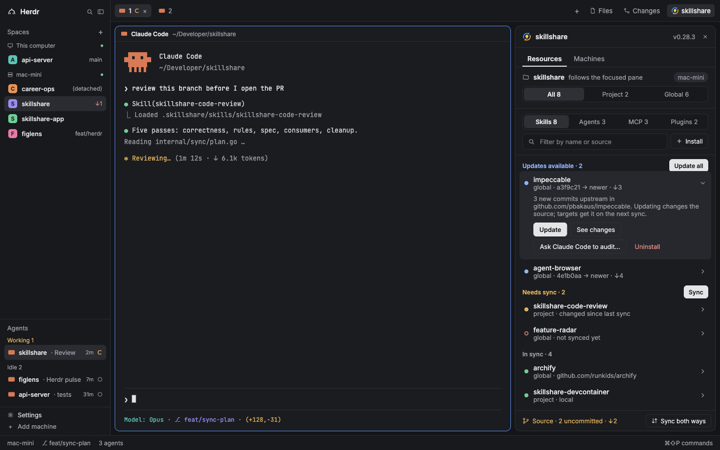

# workstation

My [Herdr](https://herdr.dev) setup: the **Tony** layout, the mods it uses, and my keybindings.



## Install the Tony layout

The layout needs the mods it references. `mount.sh` symlinks the layouts, themes and mods from this repo into your Herdr config folder (`~/.config/herdr-app`), so edits on either side are the same files and nothing needs copying again:

```sh
git clone https://github.com/AnthonyThomasson/workstation.git
cd workstation
./mount.sh --dry-run   # preview
./mount.sh
```

Any real file or folder it replaces is moved to `~/.config/herdr-app/.workstation-backup/<timestamp>/`. Re-run it after adding new files to the repo or moving the repo. Herdr picks up linked layouts and mods without a restart; then pick **Tony** in the layout picker.

Tony also uses Herdr's built-in `spaces`, `agents`, `changes`, `files`, `pane` and `workspace-chrome` mods.
The `github-tasks`, `skillshare` and `workflows` mods expect the `gh` and `skillshare` CLIs to be installed.

## Contents

- `herdr-app/layouts/` the Tony layout
- `herdr-app/mods/` custom mods
- `mount.sh` links the layouts, themes and mods into Herdr's config folder
- `herdr-app/keys.json`, `settings.json` keybindings and settings (optional, not linked: Herdr writes to them)
- `skillshare/` Skillshare config and skills
