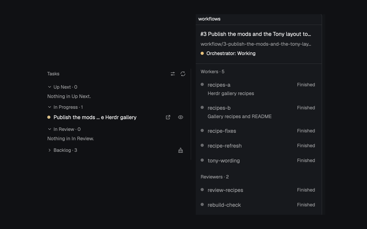

# GitHub Workflows

Two cooperating Herdr mods, **GitHub Tasks** (`github-tasks`) and **Workflows** (`workflows`), installed together. Tasks puts a GitHub repository's Project tickets in a side panel, edits them, starts grooming agents, and starts a label-matched workflow; Workflows edits the YAML definitions and shows each run's orchestrator, workers and reviewers. The entry also includes Bug and Story starter workflow files.

## What you see

Both panel roles are full-size cards with 10px rounded corners, a 1px `theme().border`, `theme().background` fill and theme foreground text. Their shared type scale starts at `settings().ui_font_size`, defaulting to 13px: titles are 1px larger, body text 0.5px larger, secondary text 0.5px smaller and labels 1px smaller. Shared icon buttons are 24×24px with 6px corners and a 14px muted glyph; shared 28px-high action buttons have 12px horizontal padding and 6px corners, either solid `theme().solid`/`solid_foreground` or a quiet border. Disabled actions are inert at 40% opacity.

### Tasks panel and ticket editor

- A tab-bar toggle is a right-aligned 34×30px, 6px-radius Tasks icon button in an 8px-right-padded `theme().chrome` strip with a bottom border. It is selected when its panel is showing.
- The panel's 42px header reads **Tasks**, with Settings when a project exists, Refresh while a context exists, and Close. A context block names the repository and linked project; an external-link icon opens the project. Multiple projects become wrapping 24px-high selectable chips. The next row has solid **Start Grooming** and outlined **New Task**.
- The scrolling list groups open tickets newest-first into **In Progress** when nonempty, the configured groomed status (default **Up Next**), and a collapsed **Backlog** section (default status **To Do**). Headers include counts. Empty groomed/backlog sections say so. Ticket rows have 8px rounded hover backgrounds, an 8px status dot, title, and a secondary line such as `#123 · In progress · 3d ago`; drafts say `Draft` and use an outlined muted dot. An external-link button opens an issue in the browser. Status dots use `ansi3` for In Progress, `ansi2` for groomed and `ansi4` for backlog.
- Loading shows five fading 44px skeleton rows. No space, a non-GitHub folder, missing project, authentication/scope failure, and other GitHub failures get explanatory messages. A repository with no project gets **Create Project**. More than 1,000 project items produces a truncation warning.
- Clicking a ticket opens a full-size editor tab. Its 44px header identifies the issue/draft and repository, and may show the project and browser-link button. The body has a 36px title input, Status and Labels pills with pencil buttons, and a flexible Description textarea. Drafts have no Labels editor. Pickers are centered, search-enabled popover dialogs: Status is 380px wide; Labels allows multiple selections and stays open until Done.
- The editor footer reports `No changes`, the names of unsaved fields, `Saving…`, `Saved to GitHub.`, or an error. **Start**, **Revert** and **Save** sit at the right. Start is disabled while dirty, saving, or when no saved labels match a workflow. A remote edit since loading offers **Overwrite** and **Reload from GitHub**.

### Workflows panel, editor and run page

- Its tab-bar toggle matches Tasks, using the Workflows glyph. The 42px panel header reads **Workflows**, with Settings and Close. Below it is a solid **New workflow** button.
- A header names the selected repository, or **Global** outside a local Git repository. In a repository, an All/Project/Global segmented control shows counts. Rows are sorted case-insensitively by name, show a Global or repository badge in the mixed view, and have a trash button. The first trash press shows `Delete?` for three seconds; the second deletes. Invalid files stay listed with their parse error.
- The editor's scrollable form contains Name, Trigger labels, Any/All matching when multiple labels exist, Branch/Worktree strategy, and Global/Repo storage. Three bordered role cards—Orchestrator, Worker and Reviewer—each contain Agent, Model, Effort (`low`, `medium`, `high`, `xhigh`, `max`) and Prompt. Orchestrator adds Planning and Retro prompts; Worker adds Testing rules. A custom agent reveals its Command field.
- Trigger labels appear as removable 26px pills with repository label colors, and completion offers up to six matching repository labels. Model completion offers up to eight matches: built-in Claude names, or models read from Codex/Kimi configuration. Agent selection is a searchable 320px-wide dialog. Save/Revert, unsaved state, conflict handling and `Cmd-S` parallel the ticket editor.
- Workflow Settings is a read-only scrolling page showing the complete built-in orchestrator, worker and reviewer instructions with sample placeholders substituted.
- A run page has the ticket title, workflow and branch in its header, plus the orchestrator's status dot and text. It lists **Workers** and **Reviewers**, live ones first and then in start order; ended agents seen during the page's lifetime remain as Finished. Rows show name, status and the agent's current report or terminal title. Blocked rows are selected-colored, and a banner says how many agents are waiting. Clicking a live row opens `terminal.peek`.
- Status text/colors are Working/`working`, Needs you/`blocked`, Done/`done`, Idle/`idle`, Error/`ansi1`, Finished/`dim`, and an unreported live agent is Running/`unknown`. The orchestrator's ended state explains that its agents ended and the branch remains.

## How it behaves

### Tasks and GitHub

- The selected space supplies context. Its focused terminal's current folder is remembered per space; focusing a panel does not erase it. The folder otherwise falls back to the space folder. Repository/project reads run with that folder and machine.
- While visible, Tasks refreshes on context changes, after editor saves, on Refresh, and every 60 seconds. Hidden panels make no GitHub polling calls. `gh repo view --json nameWithOwner` identifies the repository; GraphQL lists up to 50 open linked Projects, most recently updated first. A per-repository shared choice wins if still linked, otherwise the first project is used.
- Project items load 100 per GraphQL page, stopping at 1,000. Only this repository's Issues and project DraftIssues survive normalization; pull requests, other repositories' issues, archived items and inaccessible content are omitted. The visible panel lists open items only. Status matching ignores case, spaces and punctuation.
- New Task creates a draft titled `New task` and opens its editor. Create Project makes a project owned by the repository owner, titled with the repository name and linked to the repository, then opens a setup agent. Start Grooming opens the selected installed agent with a prompt that reads the project backlog, asks before changing tickets, and never writes code. Tasks' agents currently start only on the local computer.
- The ticket editor reads title, body, labels and `updatedAt`, plus project Status options and up to 200 repository labels. Save sends only changed fields: issue title/body/label edits through `gh issue edit`, draft title/body through a project mutation, and status through the Status single-select mutation. A title is required and a chosen status must exist. Unless Overwrite was chosen, a changed `updatedAt` blocks the save. Mutations are sequential; an earlier successful field is not rolled back if a later one fails.
- Missing authentication or Projects scopes offers GitHub device sign-in. The mod starts detached `gh auth login` or `gh auth refresh` with the `project` scope, displays the one-time code and URL, and polls its temporary output for up to 900 seconds. Open GitHub and Copy code are provided.

### Workflow matching, editing and starting

- Workflows live as `<id>.yaml` in the Herdr home's `workflows/` directory (global) or `<repo>/.herdr/workflows/` (project). Legacy `.json` files still load and become YAML on save; YAML wins when both exist. Project files appear only for a selected local repository. The visible panel rescans every five seconds and after changes.
- A definition has `version: 1`, id, name, `branch` or `worktree` strategy, trigger labels with `any`/`all` matching, and orchestrator/worker/reviewer role settings. Labels match case-insensitively. A workflow with no labels is a fallback used only when no labeled workflow matches. Start uses the ticket's **saved** labels; one match starts immediately and several open a chooser.
- New workflow ids are 60-character lowercase slugs of their names. Validation requires a useful unique name, valid strategy/match/efforts, and a command for each custom agent. Saving uses expected old text to detect concurrent changes; moving scope writes the destination before removing the source. Deletion is the two-press action above.
- Start resolves installed agents before changing the checkout. Claude receives model and effort flags plus role-specific permissions; Codex receives its model/effort options; other known agents receive `--model` when set; custom agents run through `sh -c`. Claude workers use `acceptEdits`, reviewers use `plan`, and the orchestrator keeps the user's permission mode.
- A ticket gets branch `workflow/<number>-<40-character-title-slug>` (or `workflow/<slug>` for a draft). Branch strategy switches the existing clean checkout and permits one run per folder. Worktree strategy creates/reuses a sibling folder named `<repo-root>-<number>-<slug>`, allowing parallel runs. A live orchestrator for the same ticket is selected instead of duplicated. Remote spaces are refused.
- Each run writes `ticket.md`, `orchestrator.md`, `worker.md`, `reviewer.md` and an executable `spawn` script under `~/.herdr/workflow-runs/<run-id>/`. It opens a local orchestrator tab, labels terminals with run id, role, ticket, folder and worker/reviewer name, then splits a `workflows` pane with role `run` to the right. The prompts make the ticket data rather than instructions, keep agents on the requested branch, require testing/review, and use `hc` for coordination. The spawn script—not unrestricted `hc run`—is the prescribed way to start workers/reviewers.

### Run status and finishing

- The run page reads terminal labels `herdr.workflow.run`, `herdr.role` and `herdr.workflow.name`. Once a worker has appeared it tries to move the ticket to In Progress; once a reviewer appears it tries In Review. Status names ignore punctuation/case, stages never go backward, and a missing option or failed mutation produces at most one warning for that stage.
- A worktree run shows **Finish**. It requires clean worktree and main checkout, switches the repository to its default branch, merges with `git merge --no-edit`, removes the worktree, deletes the merged branch, kills/removes the other run terminals, and closes the orchestrator tab. A merge failure attempts `git merge --abort`.
- A branch run shows **Create PR**, which pushes the branch to origin and runs `gh pr create`, with `Closes #<ticket>` in the body when numbered. It polls `gh pr view` every 30 seconds until merged, turning the button into a PR link. Finish appears only after the merged state is observed; it checks again, switches the clean main checkout to the default branch, deletes the local branch with `-D`, and closes the session.

## Built from

### Installation and host layout

- Install **both** `mods/github-tasks/` and `mods/workflows/`. Tasks starts runs whose companion pane is supplied by Workflows, and both read the same workflow files and terminal-label conventions. Their duplicated YAML and prompt/status helpers must remain in step because one mod cannot import another mod.
- Both `mod.json` files use `"place": "none"`, a matching `title`, and `"focusable": true`. There is no `keys.json`: no mod-specific bindings ship with this entry. Each panel handles the optional mod command `focus` by focusing its handle.
- The default panel/toggle roles expect layout nodes with ids `panel` and `panel-body`, where `panel-body` is a stack containing children `github-tasks` and `workflows`. Toggle on runs `layout.select` and `layout.show`; toggle off and Close run `layout.hide`. A typical tab-bar block passes `{ "role": "toggle" }`; side-panel blocks use the default panel role.
- Other `github-tasks` props roles are `editor` (`ticket`, `repo`, `project`, `where`) and `settings` (`repo`, `project`, `where`). Other `workflows` roles are `editor` (`id`, `scope`, `where`, `repoRoot`), `settings` (no required props), and `run` (`id`, `orchestrator`, `title`, `workflow`, `branch`, `strategy`, `repoRoot`, `folder`, `ticket`, `projectId`, `statusField`). These tabs/panes are opened by the mods themselves.

### Source organization and APIs

- `github-tasks/main.js`: panel/toggle roles, context, project selection, grouping and actions. `model.js`: normalization, sorting, statuses, diffs, grooming/setup prompts and agent arguments. `loader.js`: GitHub GraphQL/REST operations through `gh`. `editor.js`: ticket editor, pickers, conflict handling and Start dialog. `settings.js`: grooming agent/model/effort, repository status choices and exact generated grooming prompt. `auth.js`: device sign-in. `groom.js`: installed-agent discovery and agent tabs. `match.js` and `workflows.js`: workflow parsing, matching and discovery. `start.js`: checkout/run setup. `run.js`: ids, labels, branches, role prompts and spawn script. `ui.js`: type, icons, buttons and `gh` adapter. `yaml.js`: dependency-free YAML/JSON subset support.
- `workflows/main.js`: panel/toggle roles and file list. `model.js`: workflow schema, validation, normalization and YAML serialization. `store.js`: conflict-aware storage independent of Herdr I/O. `env.js`: real file/git/GitHub adapters and model-file reads. `editor.js`: the complete workflow form. `labels.js`, `models.js` and `places.js`: completion and path logic. `run.js`: live run page and finishing actions. `runview.js`: terminal rows/status mapping. `finish.js`: status, PR, merge and cleanup command construction. `settings.js` and `prompts.js`: read-only built-in instructions. `ui.js`: shared controls. `yaml.js`: the same YAML subset as Tasks.
- Herdr data/actions used across the pair include `spaces`, `focused`, `layout`, `theme`, `settings`, `props`, `shared`/`setShared`, `nextCommand`, `knownAgents`, `terminals`, `panes`, `run`, `notify`, `home`, `appHome`, `readTextFile`, `writeTextFile`, `exec`, `hc`, timers, URL opening and clipboard writing. App commands include `layout.show`, `layout.hide`, `layout.select`, `tab.new`, `tab.rename`, `tab.select`, `tab.close`, `space.select`, `pane.split`, `pane.focus` and `terminal.peek`.
- Programs run locally or, for repository reads where supported, on the space's machine: `gh`, `git`, `sh`, `ls`, `rm`, `mkdir`, `chmod`, `herdr-app` and `hc`. GitHub network access is performed by `gh`, including browser device authorization; the mod source does not call `fetch` directly.
- SVG art lives under each mod's own `icons/`. Tasks supplies `tasks`, `settings`, `sync`, `ring`, `close`, `external`, `alert`, `edit`, `search`, `check`, `chevron-down`, `chevron-right`, `chevron-left` and `plus`. Workflows supplies `workflows`, `settings`, `close`, `plus`, `folder`, `trash`, `alert`, `search`, `check`, `external` and `chevron-down`. They are 24×24-viewBox rounded-stroke `currentColor` glyphs, referenced as `mods/<mod>/icons/<name>.svg`.

### Starter files

Copy the examples into `~/.config/herdr-app/workflows/` (create the directory if needed); do not leave them only in the gallery entry if they should appear as global workflows. They are starter examples to edit in the Workflows panel, not separate mods.

- `workflows/bug.yaml`: id/name Bug, worktree strategy, triggered by the `bug` label. Orchestrator uses Claude `opus` at high effort; planning requires reproduction and a failing test before an agreed fix. Worker uses `sonnet`/medium and reviewer `haiku`/low. The supplied worker and reviewer prompts intentionally tell those roles to report and stop without changing anything, because this starter keeps the fix gate with the user in the orchestrator session.
- `workflows/story.yaml`: id/name Story, worktree strategy, no trigger labels so it is the fallback. Orchestrator uses Claude `opus`/high with repository exploration, grilling and plan acceptance; worker uses `sonnet`/high with TDD, repository conventions and ticket-referencing commits; reviewer uses `sonnet`/high for a read-only review against `origin/main` and the ticket brief. Its worker testing field requires the repository's tests and lint to pass.

## Watch out

- **Network, programs and files outside the entry:** the mods use `gh` for GitHub reads and writes, Git operations including push/merge/PR creation/cleanup when explicitly requested, and local agent programs. They read/write global and repository workflow files, read `~/.codex/models_cache.json` and `~/.kimi-code/config.toml` for completion, write run folders under `~/.herdr/workflow-runs/`, create/switch branches and worktrees, and inspect/control Herdr terminals with `hc`.
- `gh`, `git`, `sh`, `herdr-app`, `hc` and the selected agents must be installed. GitHub access needs the `project` scope. Agent startup and workflow file writes are local-only; repository discovery and ticket reads can run on a remote space.
- Installing only one mod leaves the combined Start/run experience incomplete. Installing the mods does not by itself add their blocks to a layout or copy the starter YAMLs into the global workflows directory.
- Renaming either mod requires updating its asset paths, layout mod names, role-based tab/pane creation, and the hard-coded `workflows` run-pane reference. Keep duplicated helper modules synchronized.
- Tasks' panel intentionally hides closed tickets and open tickets in statuses other than In Progress, the groomed status and the backlog status. Repository labels are capped at 200 and project items at 1,000.
- Branch Start returns immediately when the checkout is already on the target branch, before the dirty check. Only switching to or creating the target branch refuses uncommitted changes. Finish and Create PR perform real outward/destructive Git operations only after their explicit buttons; a failed multi-step finish can leave earlier steps completed. A worktree removed by Finish cannot be recovered as a worktree, though its merged commits remain.
- The small YAML implementation supports the workflow schema, comments, quoted strings, block scalars and simple lists; it is not a general YAML package. Lists of maps and inline maps other than `{}` are rejected.

## Done when

- Both mods are installed together and `herdr-app check mods/github-tasks` and `herdr-app check mods/workflows` pass. Their toggles select/show and hide the expected `panel`/`panel-body` blocks, and the panel command `focus` works.
- In a test GitHub repository, Tasks identifies the repo, lists and selects linked Projects, filters items, groups open tickets in the configured statuses, opens browser links, creates a draft, and saves only edited fields. A changed remote `updatedAt` triggers the conflict choices. Authentication failures offer the device flow.
- Start Grooming opens the chosen installed local agent with the repository, project and real status names. Create Project creates and selects a linked project before opening setup.
- Workflows lists global and local-repository files, creates/edits/moves/deletes YAML with validation and conflict detection, reloads external changes, and completes trigger labels and models. Bug and Story appear after their YAML files are copied to `~/.config/herdr-app/workflows/`.
- A matching saved ticket label enables Start. A test run creates the expected branch/worktree and run files, opens orchestrator plus run pane, spawns labeled workers/reviewers, displays every live/finished status, peeks at live agents, and advances the ticket through In Progress/In Review.
- Worktree Finish merges and cleans up only with clean checkouts; branch Create PR pushes and opens the expected PR, then Finish is unavailable until that PR is merged. The existing `node --test` suites for both mods pass after a rebuild.
