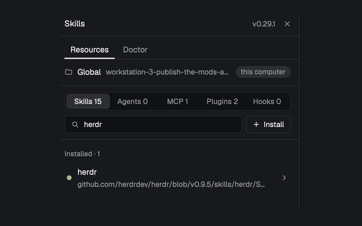

# Skills

A Skillshare control panel for the active Herdr space: browse global and project skills, agents, MCP servers, plugins and hooks; find updates; install from a Git URL with an audit step; read skill files; ask an agent to audit; uninstall or change hooks; and inspect doctor findings. This is a modified copy of runkids's MIT-licensed [`skillshare` mod](https://github.com/runkids/skillshare), copyright (c) 2025 runkids; the MIT license ships as `mods/skills/LICENSE`.

## What you see

- The `toggle` role is a right-aligned 34×30px, 6px-radius button in a `theme().chrome` tab-bar strip, with a 16px Skillshare glyph. It uses `theme().selected` and foreground text while its panel is open, and `theme().hover` on hover.
- The panel is a full-size `theme().background` card with 10px rounded corners, a 1px `theme().border`, and theme foreground text. The 42px header reads **Skillshare**, shows the CLI version when known, and has Close when hosted in the expected layout panel. Type follows `settings().ui_font_size`, default 13px: title 14px, body 13.5px, secondary/button text 12.5px and labels 12px.
- **Resources** and **Doctor** are 30px-high tabs. Resources names the current project folder and machine, explains when the folder is not a Skillshare project, and—when a project exists—has All/Project/Global scope counts. A second segmented control selects **Skills**, **Agents**, **MCP**, **Plugins** or **Hooks**, each with a count. A name/source filter and **Install** sit below.
- The scrolling resource list puts **Updates available** first, with **Update all**, then **Installed**. Rows are at least 48px high, with an 8px state dot, name, optional project root, source/version/update subtitle, and chevron. Update dots use `theme().accent`, healthy rows `ansi2`, and disabled rows a hollow muted dot. Disabled entries are hidden by default, with a **Show disabled · N** control. Loading shows five fading 40px placeholders; errors and empty/filter results get explicit messages.
- Expanding a row gives it a `theme().raised` body with details and wrapping actions. Skills and agents offer **Read** and **Uninstall**; updates offer **Update**, and skills also **See changes**. A focused or most recently used agent enables **Ask <agent> to audit…**. Top-level hooks offer applicable **Enable**, **Disable** and **Remove** actions. MCP and plugin rows are informational and list their targets.
- Doctor has **Run doctor**, optional **Fix**, and per-scope counts followed by red error and yellow warning cards with details. Warnings can be ignored after confirmation; an expandable Ignored section can restore them. A 34px footer shows a spinning busy step or a dismissible success, information, warning or error notice.
- Dialogs have 18px padding, a title and Esc hint, themed inputs/buttons, and a flexible body. They include a 480×500 URL installer, 760×620 Markdown skill reader, 620×520 command-output viewer, 480×380 audit composer, and smaller uninstall/hook/ignore confirmations. Installation progresses through Download, Audit and Install, with replace, audit-block and completion cards.

## How it behaves

- The panel follows the active space and runs on that space's machine. The focused terminal's folder in that space wins over the space folder. The first candidate containing `.skillshare/config.yaml` is the project; without one, only global resources are read. Changing space, folder or project resets the visible data and starts fresh reads.
- Resources refresh when shown or changed and every 20 seconds while visible and not busy. A refresh reads `skillshare status --json -g`, plus global and applicable project `list --all --json`, `mcp list --json`, `plugin list --json` and `hooks list --json`. Update checks (`skillshare check --json` and `skillshare check agents --json`) run on project/scope changes and at most every ten minutes; these checks ask source remotes about updates. Hidden panels do not perform the 20-second refresh.
- Rows group by update/enabled/disabled state and sort alphabetically within each group. Filtering matches name and source (plus hook root/reason). Update and Update all change the source itself, not just linked targets. Security-blocked updates stop with an instruction to audit first. Uninstall confirms, then uses Skillshare's trash; the confirmation notes that its uncommitted-changes check is skipped.
- **Read** loads a project's `.skillshare/skills/<path>/SKILL.md` or `.skillshare/agents/<name>.md`, or the corresponding file under `~/.config/skillshare/`, and displays it as selectable Markdown. **See changes** runs `skillshare check <name> --diff` in the proper scope and shows the output. Audit sends a prepared `skillshare audit … --json` request to the selected agent with `hc send`, focuses it on success, and refuses to send while that agent is blocked or ended.
- Install accepts `owner/repo`, a GitHub/Git URL, SSH, `file://`, an absolute path or `~/…`, including links to a branch or one skill file. It shallow-clones with terminal prompts disabled, finds `SKILL.md` files outside `.git` and `node_modules`, and lets the user choose when several exist. Before installation it audits the temporary clone in the chosen project/global scope. Blocking findings show severity, file, line and snippet; the user can cancel, ask the current agent to review, or explicitly **Install anyway**. Existing skill names require a separate Replace confirmation because local edits are overwritten.
- Installation calls `skillshare install <source> --json` with `-p` or `-g`, selected skill names and `--force` only after the relevant confirmation/override. Closing during the actual install leaves the detached job running and the list refreshes on completion. Closing during discovery/audit removes the temporary clone and prevents installation. The six most recent sources are remembered in shared state.
- Hook Enable/Disable/Remove applies only to declared top-level hooks, not project-root-specific entries. Doctor runs `skillshare doctor --json` for global and, if present, project scope. Ignored warnings are hidden by a persisted `scope|name|message` key but remain in CLI output.
- Doctor **Fix** writes pending errors and unignored warnings to `~/.cache/skillshare-panel/doctor-fix.md`, copies a one-line prompt with `pbcopy`, opens a local `claude` tab named **Fix skillshare**, waits 1.5 seconds and pastes the prompt without pressing Enter. The generated file treats doctor output as data and asks Claude to investigate, fix and rerun doctor.
- Work is serialized by a per-machine lock. Long commands run detached, write `pid`, `out`, `err` and `code` under a `skillshare-panel.*` temporary directory, and are polled every 500ms for up to 15 minutes. Stale abandoned job folders are swept; different machines do not wait for one another.

## Built from

- Install only `mods/skills/`. `mod.json` is `{ "place": "none", "title": "skills", "focusable": true }`; no key bindings ship. The optional mod command `focus` focuses the panel handle.
- The default role is `panel`; `toggle` is the tab-bar button. The host layout should use column `panel` and stack `panel-body`, with this panel as child `skills`. Toggle calls `layout.select` and `layout.show` to open it, and `layout.hide` to close. Dialog roles are `install`, `uninstall`, `audit`, `text`, `skill`, `ignore` and `hook`, opened as `skills` overlays by the panel.
- `main.js` implements all views, context, polling, dialogs and actions. `model.js` parses CLI JSON, normalizes/filter/groups rows, builds audit messages and holds shell scripts. `loader.js` reads resources and update state; `operations.js` performs update, hook, uninstall and diff operations. `jobs.js` implements short and detached command execution; `channel.js` provides per-machine locks, work requests and notices.
- Herdr APIs used include `exec`, `hc`, `run`, `spaces`, `agents`, `focused`, `layout`, `theme`, `settings`, `props`, `shared`/`setShared`, `nextCommand`, `openOverlay`/`closeOverlay`, `readTextFile` and timers. App commands include `layout.select`, `layout.show`, `layout.hide`, `tab.new`, `agent.focus` and `terminal.paste`.
- The mod runs `sh` and the `skillshare` CLI; installation discovery runs `git clone`; Doctor Fix opens `claude` and uses `pbcopy`. Shell scripts also use standard utilities including `cat`, `date`, `find`, `grep`, `kill`, `mktemp`, `printf`, `ps`, `rm`, `sed`, `sleep`, `sort`, `tail` and `setsid` where available. PATH is extended with `~/.local/bin`, `~/go/bin`, `/opt/homebrew/bin` and `/usr/local/bin`, and `SKILLSHARE_THEME=dark` is set to suppress terminal-theme probing.
- Network access is indirect but real: `git clone` retrieves installer sources, and Skillshare check/install/update/audit operations can contact source repositories and package registries. The source has no direct `fetch` call. Outside its own folder it reads global/project Skillshare files, writes/removes Skillshare resources through the CLI, creates and removes temporary clones/jobs, and writes the Doctor Fix cache file.
- Art is `icons/skillshare.svg`, `alert.svg`, `check.svg`, `chevron-down.svg`, `chevron-right.svg`, `close.svg`, `folder.svg`, `git.svg`, `plus.svg`, `ring.svg`, `search.svg` and `sync.svg`. Icons are 24×24-viewBox assets referenced as `mods/skills/icons/<name>.svg` and tinted with theme colors. Preserve `LICENSE` with the mod.

## Watch out

- **Programs, network and writes:** this is a management UI, not a passive list. It clones arbitrary user-supplied sources, runs Skillshare operations that modify global/project resources and target links, sends text to agents, and can paste a Doctor Fix prompt into Claude. Review sources and audit findings; **Install anyway** deliberately bypasses the panel's audit stop.
- `skillshare`, `sh` and `git` are required for their respective functions. Agent audit needs a live compatible agent; Doctor Fix assumes `claude` and macOS `pbcopy`. Its paste is not submitted automatically. CLI failures and older output formats can leave update/audit information unknown; install still lets the CLI perform its own audit.
- Update changes the tracked source. Uninstall moves entries to Skillshare trash rather than permanently deleting them, but project uninstall uses `--force`. Replacing an installed skill overwrites local edits after confirmation. Only top-level hooks can be changed here; MCP servers and plugins have no row actions.
- The button expects the host layout ids above. Installing the mod without adding its panel/toggle blocks leaves it undocked because `place` is `none`. Renaming it requires changing asset paths, overlay mod names and layout references.
- Long jobs are detached specifically so closing a dialog does not necessarily cancel work. Do not replace this with an ordinary awaited `exec` and assume closing stops installation. Herdr's usual 30-second `exec` limit and `HC_SCOPE` cleanup are why the runner uses a separate process group.
- There are no `keys.json` entries to merge and no built-in screenshot asset to reproduce; `preview.png` belongs to the gallery entry, not the installed mod.

## Done when

- `herdr-app check mods/skills` passes. In the intended host layout, its toggle selects/shows and hides `panel`/`panel-body`, and the `focus` mod command focuses the panel.
- With the Skillshare CLI available, Resources identifies global and project scopes, lists all five kinds with counts, filters, hides/shows disabled rows, and refreshes only while visible. Source/update states and errors match the CLI JSON.
- Read opens the correct project/global Markdown file. Update, Update all, See changes, hook actions and Uninstall run the correct scope, hold the machine lock, and report their real result. Agent audit refuses blocked/ended agents and otherwise sends and focuses the agent.
- Install handles repository and single-skill URLs, multiple-skill selection, existing-name replacement and audit stops. Nothing is installed after a discovery/audit dialog closes; closing during the actual detached install still allows completion and refresh.
- Doctor lists errors/warnings, persists ignored/restored warnings, and Fix writes the report and pastes—not submits—the prompt into a new Claude tab. Temporary job folders are cleaned or swept as documented.
