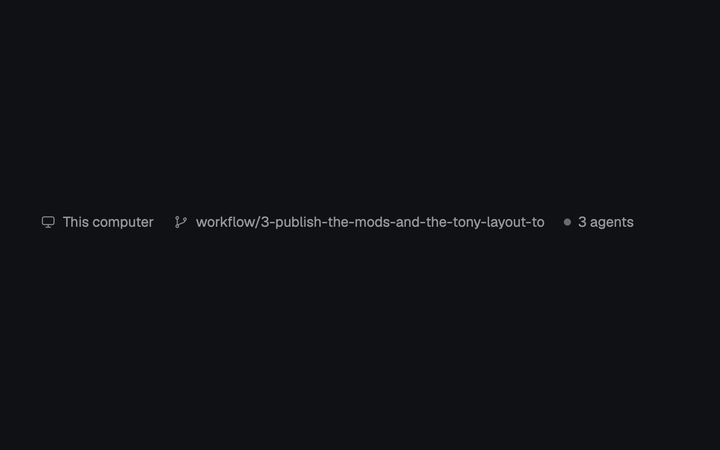

# Status Bar

A slim, read-only bar for the bottom of a Herdr workspace. It identifies the active space's computer, shows its current Git branch when known, and summarizes all agents, highlighting how many are blocked and need an answer.

## What you see

- One horizontal row filling its block, with a `theme().chrome` background, a 1px `theme().border` line along the top, 14px horizontal padding, and 16px between its three groups. Items are vertically centered.
- All text is 11.8px and `theme().muted`; icons inherit that color.
- **Computer:** a 13px monitor icon followed by `This computer` for a local active space. For a remote space, a 13px server icon and the machine's name appear instead. With no active space, the local monitor and `This computer` remain.
- **Branch:** when the active space has a branch, a 13px branch icon and the branch name. This group is absent when no branch is reported.
- **Agents:** a 6×6px dot with 3px corner radius in `theme().dim`, 6px ahead of text such as `4 agents`. The count includes every entry returned by Herdr's `agents()`, regardless of status. If any are blocked, the same group adds `· 2 needs you` in `theme().blocked`; the singular grammar is still `1 needs you`.

## How it behaves

- The display rerenders from Herdr's live `spaces()`, `agents()` and `theme()` data. Selecting another space changes the computer and branch; starting, finishing or changing an agent's status changes the count and blocked summary.
- Only agents whose status is exactly `blocked` contribute to `needs you`. Working, done, idle and unreported agents still contribute to the total but get no separate status label or color.
- Nothing is clickable, hoverable, animated or keyboard-driven. The bar does not select an agent or open a panel.

## Built from

- `mods/status-bar/mod.json`: `{ "place": "none" }`. Add an explicit block for `status-bar` to the host layout, normally as a fixed-height bottom bar.
- `mods/status-bar/main.js`: a `View` subclass whose `render()` uses `gpui-kit` `div` and `svg`, `gpui-base` `h_flex`, and Herdr's `spaces`, `agents` and `theme`. A small `label(name, text)` helper pairs each 13px SVG with text, with a 6px internal gap.
- Used assets are `icons/monitor.svg`, `icons/server.svg` and `icons/branch.svg`: simple 24×24 viewBox, `currentColor` line icons with rounded strokes. The entry also carries unused `both.svg`, `git.svg` and `ring.svg` assets; they are not rendered by this version.
- It starts no timers and runs no external programs.

## Watch out

- This is a passive summary, not an agent list: there is no per-agent breakdown and no click-to-focus action.
- The mod has no intrinsic height. The layout must give its block a suitable fixed height; the source only controls the row's padding, type and top border.
- Image paths are relative to the Herdr home. If the mod is renamed, change every `mods/status-bar/icons/...` path too.
- It reads no files outside its own folder, makes no network requests, and does not invoke `exec`, `hc` or `gh`. No key bindings are required.

## Done when

- `herdr-app check mods/status-bar` passes and the host layout shows a single bottom row with the specified spacing, colors and 11.8px type.
- Switching between a local and a remote active space switches `This computer`/monitor to the machine name/server; a reported branch appears and disappears with the space's branch data.
- With zero agents the last group reads `0 agents`; with working, done and idle agents only the total changes; adding blocked agents adds the exact `· N needs you` suffix in the blocked color.
- Clicking or hovering any part causes no command, navigation or visual control state.
