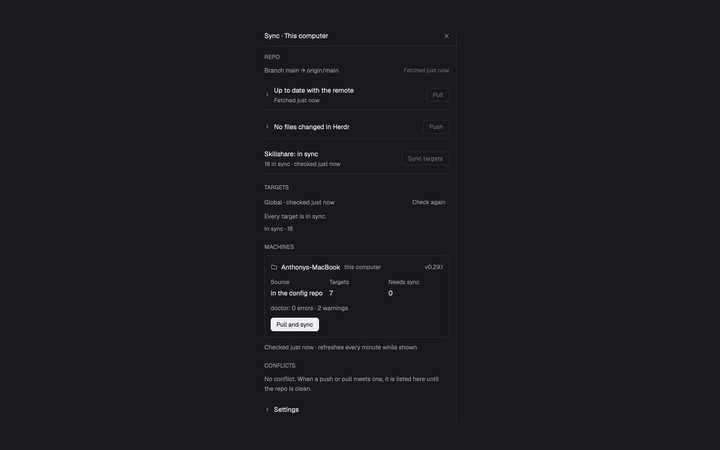

# Sync

A Herdr tab-bar button and side panel that keep a Git configuration repository and `~/.config/herdr-app` in step. It shows incoming commits and local changes, pulls or pushes on request, synchronizes Skillshare targets, reports every configured machine, and helps resolve conflicts without tying the mod to one particular repository.

## What you see

- The default role is a right-aligned 34×30px button with 6px corners in a `theme().chrome` tab-bar strip. Its 16px circular-arrow icon is dimmed until a repository is configured, muted normally, foreground when its panel is selected, `theme().blocked` on an error or conflict, and spins once every 900ms while busy. A small 9px yellow down arrow means the repository is behind its upstream; an up arrow counts changed files only, not unpushed commits (those appear in the Push row). Both sit at the button's top-right, with no numbers.
- Clicking the button opens **Sync · <machine>** in the host layout's shared side panel. The panel is a full-size `theme().background` card with 10px corners, a 1px `theme().border`, a 42px title bar with Close, and a scrolling body with 14px horizontal padding and 18px between sections. Its type scale is based on `settings().ui_font_size`, default 13px: title 14px, body 13.5px, secondary/buttons 12.5px and labels 12px.
- Sections appear top to bottom as **Repo**, **Targets**, **Source** when relevant, **Machines**, **Conflicts**, and a collapsible **Settings**. Before a repository is configured, Settings is the only section and is forced open.
- Repo shows the branch and upstream, fetch age, a Pull row, a Push row with an editable generated commit message, and a Skillshare target-sync row. Pull expands to incoming commits, repository files newer than Herdr, and Herdr changes that Pull would replace. Push expands to the changed-file list and unpushed-commit count. Disabled actions are dimmed and inert.
- Targets lists project and/or global Skillshare items needing synchronization, notices, unknown states, and in-sync/disabled counts. Expanded rows show details and, where supported, **Diff**. Source appears for a Skillshare source in its own Git repository: path, remote, branch, dirty/ahead/behind pills, changed files, commit message, **Both ways**, **Pull**, and **Commit and push**.
- Machines has one bordered card for this computer and each Herdr machine, with Skillshare version, source state, target and drift counts, doctor totals, **Pull and sync**, and an update button when another card has a newer Skillshare version. Conflicts explains the stopped operation and can show side-by-side local/remote file previews with whole-file **Keep this** choices. Text and confirmation dialogs use an 18px-padded `theme().popover` frame and support Escape.

## How it behaves

- The button follows the active space's machine; repository path, sync script, conflict agent, state and locks are per machine. The button role owns all polling and work, while the Details panel and dialogs send requests to it through persisted shared state.
- With a repository configured, the local check runs every 20 seconds and `git fetch` every five minutes. Switching machines or opening the panel fetches and rereads. Skillshare targets and source state are read every two minutes by the button; a shown Details panel rereads them every 20 seconds and machine cards every minute. A fetch failure is reported without erasing the rest of the repository state.
- The check reads the branch/upstream, up to 200 incoming and outgoing commits, uncommitted files, rebase/merge state, and a two-way sync-script dry run. Files the dry run would copy to the repository count as Herdr changes; files it would copy to Herdr are repository-newer and block Push. `.sync-backup/` is excluded from Git status and commits.
- **Pull** requires an upstream. It fetches, runs `git pull --rebase --autostash` when behind, then runs the sync script with `--push` (repository to Herdr) even when no commit arrived. Herdr files replaced by the script are its responsibility to back up. After a pull, Skillshare targets are linked again when the CLI is available. A conflicting rebase is aborted; if restoring uncommitted edits clashes, the operation attempts to restore the original commit and edits and reports any stash that could not be restored.
- **Push** is refused while repository-newer files exist. Otherwise it runs the sync script with `--pull` (Herdr to repository), stages everything except `.sync-backup`, commits with the shown message, fetches and rebases onto the upstream, runs `--push` if the rebase brought commits in, and pushes to the upstream. It also works when the only work is pushing existing local commits.
- Before `--pull`, Push snapshots changed repository files. If copying Herdr would overwrite an uncommitted repository edit, it restores the repository version, saves Herdr's version under `.sync-backup/conflict-<timestamp>/herdr/`, and commits and pushes nothing. Other copied files may remain uncommitted. Regenerated Tony-copy changes are excluded from this copy-conflict check.
- Rebase conflicts are replayed for resolution. `.metadata.json` merges entry by entry without asking: one-sided changes win, and for two-sided changes the later `installed_at` wins, with an edit beating a delete. Other conflicting files can be resolved in Conflicts by choosing the whole local or remote version per file. **Apply choices** fetches again, refuses stale or newly different conflicts, commits the merge, runs `--push`, links targets, and pushes when the stopped operation was Push. **Hand it to the agent** opens the configured agent in a repository tab with a file-by-file conflict brief.
- **Sync targets** runs `skillshare sync --all` and `skillshare sync plugins` for the relevant global/project scopes. Source operations commit, pull/merge, push and relink as their labels say; Both ways asks for confirmation first. **Pull and sync** on a machine pulls its config repository, its separate Skillshare source, both, or only links targets as applicable. CLI updates require confirmation and run `skillshare upgrade --cli --force` on that machine.
- Settings fields are **Config repo** (empty by default; Browse is local-only), **Sync script** (default `./sync.sh`), and **Agent for conflicts** (default Herdr agent key `claude`, normally Claude Code). Save normalizes whitespace and persists the choices. A saved `./mount.sh` or `mount.sh` is treated as the old default and becomes `./sync.sh`.

### Sync script contract

The script is one quoted path, not a command line: absolute, `~/…`, or relative to the repository (`sync.sh` and `./sync.sh` are equivalent); spaces are allowed, arguments are not. It runs from the repository's top-level folder and must accept:

- `--push`: copy repository files to Herdr, with the repository winning.
- `--pull`: copy Herdr files to the repository, with Herdr winning.
- `--dry-run`: write nothing. With no direction flag, perform a two-way comparison and print one line per pending copy: `to repo: <path>` or `to repo (new): <path>` for Herdr-to-repository copies, and `to Herdr: <path>` or `to Herdr (new): <path>` for repository-to-Herdr copies. The mod parses those exact prefixes.

## Built from

- Install `mods/sync/`. Its `mod.json` is `{ "place": "none", "title": "sync" }`; there are no key bindings. The host layout must mount the always-present default/`button` role and should place a `details` role as child `sync` in stack `panel-body` inside column `panel`. The button calls `layout.select`, `layout.show` and `layout.hide` on those ids. Other props roles are `text`, `upgrade` and `srcboth` dialogs, opened by the mod itself.
- `main.js` owns roles, machine context, polling, shared state, locks and operations. `model.js` contains settings, output parsers, badge/count logic and conflict briefs. `ops.js` contains the Git/check/pull/push shell scripts. `jobs.js` runs slow work as detached, polled jobs; `channel.js` serializes work per machine.
- `details.js` composes `repo-ui.js`, `targets-ui.js`, `source-ui.js`, `machines-ui.js`, `conflicts-ui.js` and `settings-ui.js`. Their corresponding non-UI modules implement target parsing and commands, source Git operations, machine inspection/upgrades, and conflict replay. `repo-conflict.js` coordinates automatic metadata merges. `ui.js` supplies the themed controls and dialog frame.
- Herdr APIs include `exec`, `run`, `spaces`, `machines`, `focused`, `layout`, `theme`, `shared`/`setShared`, `knownAgents`, `pickFolder`, `openOverlay`/`closeOverlay`, `notify`, `readTextFile`, timers and `props`. App actions include `layout.select`, `layout.show`, `layout.hide` and `tab.new`.
- Programs and shell utilities include `sh`, `git`, `skillshare`, the selected conflict agent, `hostname`, `mktemp`, `rm`, `cp`, `mkdir`, `find`, `cat`, `grep`, `sed`, `awk`, `cut`, `paste`, `head`, `tail`, `tr`, `cmp`, `ps`, `kill`, `sleep` and `date`. Long jobs detach with `setsid` where available or shell job control otherwise, clear `HC_SCOPE`, poll files in a temporary directory, and time out after 15 minutes.
- Network access is through `git fetch`, `git pull` and `git push`, and through Skillshare commands that inspect, synchronize or upgrade sources and targets. The mod does not call `fetch` directly. It reads and writes the chosen config repository and causes the configured sync script to read/write `~/.config/herdr-app`; it also invokes Skillshare against its global/project configuration and writes conflict backups and temporary job files.
- Art is `icons/sync.svg`, `arrow-up.svg`, `arrow-down.svg`, `ring.svg`, `alert.svg`, `check.svg`, `chevron-down.svg`, `chevron-right.svg`, `close.svg`, `folder.svg` and `settings.svg`, referenced as `mods/sync/icons/<name>.svg` and tinted with theme colors.

## Watch out

- **Real side effects:** Pull and Push run the configured script and perform Git commits, rebases, merges, network fetches and pushes. Skillshare actions modify installed targets and can upgrade the CLI. Conflict actions write repository files and may push a merge. None of these is a simulated gallery preview.
- The button role must remain mounted even while the panel is closed; it owns the locks, timers and background work. A Details panel by itself is not enough. The `panel`/`panel-body`/`sync` ids must match the host layout or the toggle must be adapted.
- The sync script's dry-run output is an interface, not incidental logging. Missing prefixes or a script that writes during `--dry-run` produce wrong badges or unsafe Push decisions. The repository branch needs an upstream for Pull and Push.
- Copy conflicts can leave nonconflicting Herdr changes copied but uncommitted. A failed multi-step pull/rebase restoration reports the recovery state; do not claim every failure is rolled back. A stale conflict selection is deliberately refused rather than overwriting newer remote work.
- The check reads at most 200 commits in each direction; expanded UI lists are capped at 50 pull entries and 100 push files. Source state retains at most 300 uncommitted files and displays 40. Renaming the mod requires updating all `mods/sync/` asset paths and its self-opened mod name.
- `git`, `sh` and the sync script are required. Skillshare sections degrade to explanatory states when its CLI is absent. The conflict agent must be installed on the selected machine to be useful.

## Done when

- `herdr-app check mods/sync` passes. With no repository configured, only open Settings appears; saving a test repository path, script and agent enables the button and panel for that machine.
- A two-way `--dry-run` produces the exact four recognized line prefixes, and the down/up arrows track incoming commits and changed files without numbers. Opening the panel fetches; closing it stops the panel-only reads.
- In throwaway repositories, Pull applies remote commits and repository-newer files to Herdr, backs up replacements through the script, and relinks targets. Push copies Herdr changes, commits, rebases and pushes; repository-newer files block it.
- Rebase and copy conflicts push nothing, preserve the documented backups/recovery state, open the selected agent with the right files, and support whole-file choices plus entry-wise `.metadata.json` merges. Applying choices updates Herdr and, for a stopped Push, pushes the merge.
- Targets, Source and Machines perform their labeled operations on the correct local or remote machine, serialize concurrent work, and show success/error notifications. `node --test mods/sync` passes after a rebuild.
