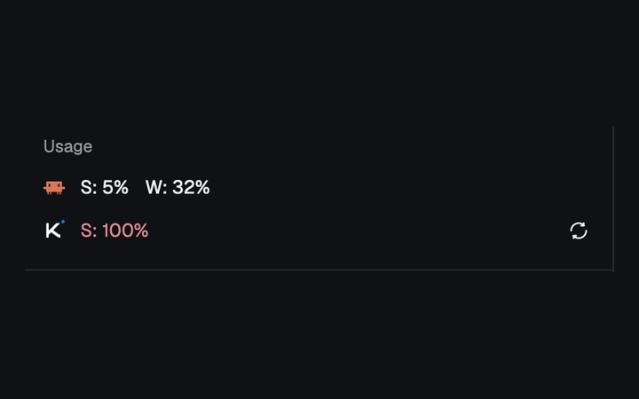

# Usage

A compact Usage block for a Herdr sidebar, with one row each for Claude and Kimi. It shows the rounded percentage of each provider's session (S) and weekly (W) allowance already used; Claude updates from a local status-line feed, while Kimi has an explicit refresh button that also refreshes the Kimi Code login.

## What you see

- A full-size vertical block with a 1px `theme().border` line across its top, 12px horizontal and 10px vertical padding, and an 8px gap between its children. The background is transparent so the host layout's background shows through.
- The heading **Usage**, in 11px semibold `theme().muted` text.
- Two 20px-high rows, 10px between their items. Each starts with a 14×14px provider logo: the orange `#D97757` Claude Code pixel mark or the blue `#1783FF` and white Kimi mark. Kimi also has a refresh control at the far right.
- Available figures read `S: 40%` and `W: 12%` in 12px text. Percentages are rounded and clamped to 0–100. A window the provider does not report has no figure at all. Fresh figures use `theme().foreground`; at 70% or more they use `theme().ansi3` (yellow), and at 90% or more `theme().ansi1` (red). If the reading is over one hour old, all its figures use `theme().muted` instead.
- Hovering a figure reports its reset time, such as `Session resets in 3h 12m`, `Weekly resets in 2d 4h`, `Session resets now`, or `Session reset time isn't reported`.
- A provider without a reading shows an 11px muted, truncating note instead: initially `checking…` for Claude and `not connected` for Kimi. Other notes are `unavailable`, `not signed in`, `sign in again`, and `refreshing…`, as applicable.
- The Kimi refresh control is a 20×20px button with 4px corners and a 13px refresh glyph. It normally uses `theme().foreground`, gains a `theme().hover` background on hover, and turns muted and spins once every 900ms while busy.

## How it behaves

- Claude is read immediately and then every 30 seconds. Its figures come from `rate_limits.five_hour` and `rate_limits.seven_day` in `~/.cache/herdr-usage/claude-status.json`, using `used_percentage` and `resets_at`. Reset timestamps may be epoch seconds or milliseconds. The file's modification time is the reading's age.
- Only a missing/falsy `rate_limits` keeps the last Claude reading on screen. A feed containing `{"rate_limits":{}}` produces and saves a reading with no session or weekly figures, replacing the previous reading and clearing its figures. A read or parse failure clears the reading and shows `unavailable`. A successful feed with falsy limits and no previous usable reading shows `not connected`.
- Kimi is never refreshed automatically. Click its refresh button, or send the mod command `refresh-kimi` (the alias `usage.refresh-kimi` also works, for example with `herdr-app do usage.refresh-kimi`). Repeated clicks while busy do nothing.
- A Kimi refresh finds the newest `~/.kimi-code/credentials/kimi-code-env-*.json`. With no readable login it says `not signed in`. Otherwise it sends that login's refresh token to Kimi's OAuth endpoint, writes the returned access/refresh tokens and expiry back in the CLI's JSON format, sets the file mode to `0600`, then requests the usage figures. A refused refresh says `sign in again`; other failures say `unavailable`.
- Kimi usage comes from `usages.limit_5h` and `usages.limit_7d`; `used_ratio` is a fraction and is multiplied by 100. Unlike Claude's numeric epoch seconds/milliseconds, Kimi's `reset_time` is a date string parsed with `Date.parse` into epoch milliseconds; an invalid or missing date leaves the reset time unreported. A window without a numeric ratio is not shown.
- The last usable Claude reading and last Kimi reading survive a restart in per-mod-copy `localStorage`, under `claude.reading.v1` and `kimi.reading.v1`. Stored-data loading catches JSON parse errors and returns `null`; it performs no shape validation on parsed values.

## Built from

- `mods/usage/mod.json`: `{ "place": "none", "title": "usage" }`. The host layout must explicitly place the mod; the intended position is below an Agents panel.
- `mods/usage/main.js`: a `View` subclass built with `gpui-kit` `View`, `div`, `image` and `svg`, plus `gpui-base` `v_flex` and `h_flex`. It uses Herdr's `theme`, `home`, `readTextFile`, `writeTextFile`, `exec`, `nextCommand`, timers and `localStorage`.
- Claude's modification time is obtained with `sh -c 'stat -f %m "$1" 2>/dev/null || stat -c %Y "$1"'`, supporting macOS and GNU `stat`.
- Kimi login discovery runs `sh` with `ls -t` and `head -1`; the credential update also runs `chmod 600`. Token and usage requests have 10-second timeouts. OAuth uses public client id `17e5f671-d194-4dfb-9706-5516cb48c098`, `POST https://auth.kimi.ai/api/oauth/token` with a form-encoded `refresh_token` grant, and `GET https://api.kimi.ai/coding/v1/usages` with the bearer access token.
- `writeTextFile` receives the exact old credential text as its expected value, so it does not overwrite a login changed after it was read. The rotated login is pretty-printed JSON with a trailing newline. It spreads every old login field, then applies this exact mapping: `access_token = data.access_token`; `refresh_token = data.refresh_token || login.refresh_token`; `expires_in = Number(data.expires_in) || 900`; `expires_at = Math.floor(Date.now() / 1000) + expires_in` (current epoch **seconds** plus the lifetime); `scope = data.scope ?? login.scope`; and `token_type = data.token_type ?? login.token_type`.
- Art: `icons/claude.svg` and `icons/kimi.svg` are the **claude** and **kimi** marks from the LobeHub icon set; `icons/refresh.svg` is the **refresh** mark from the Lucide icon set. A fresh build should fetch those named icons from those sources. Keep `icons/LICENSE-LobeHub.txt` (MIT) and `icons/LICENSE-Lucide.txt` (ISC, with the listed Feather-derived icons under MIT) with the assets.

## Watch out

- **External access and sensitive files:** this mod reads Claude's cache and the newest Kimi Code credential outside its own folder. On a Kimi refresh it sends the credential's refresh token to `auth.kimi.ai`, rewrites that credential, then contacts `api.kimi.ai`. It also runs `sh`, `stat`, `ls`, `head` and `chmod`. It does not invoke `hc` or `gh`.
- Claude does not collect usage itself. A separate status-line command must keep `~/.cache/herdr-usage/claude-status.json` populated; without that integration the row stays `not connected`.
- The Kimi refresh rotates the CLI's saved login, not just a private copy. Do not replace the expected-text write with an unconditional overwrite, and do not refresh on a timer.
- Asset paths are rooted at the Herdr home, so renaming the mod requires changing every `mods/usage/...` path.
- There are no key bindings to install and no in-mod click behavior for the Claude row.

## Done when

- `herdr-app check mods/usage` passes, and placing the mod in a layout shows the heading and both 20px provider rows without errors.
- With a valid Claude status feed containing both limits, its S/W percentages match the feed, update within 30 seconds of a feed change, use the 70%/90% colors, and show reset-time tooltips. Removing the limits does not erase the last usable reading.
- With no Claude feed, the row reports `not connected` after the initial check; malformed or unreadable feed data reports `unavailable`.
- With no Kimi credential, a refresh reports `not signed in`. With a test Kimi login, one refresh updates the credential atomically, leaves mode `0600`, displays the API's available ratios as percentages, and spins only while busy; a refused refresh reports `sign in again`.
- Restarting the mod restores the last saved readings, and no network request to Kimi occurs until refresh is explicitly requested.
