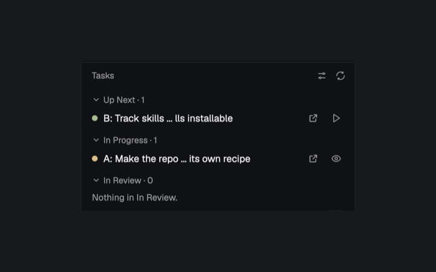

# GitHub Tasks

GitHub Tasks puts a GitHub repository's Project tickets in a Herdr navigation sidebar, edits them, starts grooming agents, edits the YAML workflow definitions that label-matched tickets start, and shows each workflow run's orchestrator, workers and reviewers with its Merge and Create PR controls. It is one mod: tickets, workflows, run pages and agent prompt views all come from `mods/github-tasks/`. Bug and Story starter YAML files are included.



## What you see

The sidebar role is unframed, sits directly in the layout and has a top border; every other role fills its tab, pane or the shared side panel with a `theme().background` fill. The type scale starts at `settings().ui_font_size`, defaulting to 13px: titles are 1px larger, body text 0.5px larger, secondary text 0.5px smaller and labels 1px smaller. Icon buttons are 24×24px with 6px corners and a 14px muted glyph; 28px-high action buttons have 12px horizontal padding and 6px corners, either solid `theme().solid`/`solid_foreground` or a quiet border. Disabled actions are inert at 40% opacity.

### The Tasks sidebar

- The 36px header reads **Tasks** in small muted text. The **Task settings** gear is always there, even with no space, repository or project, and shows a small red dot (`ansi1`, top right of the button, tooltip `Task settings (N problems found)`) while the doctor has problems to report; **Refresh** appears while a context exists and spins while loading. There is no other way into Task settings and no tab-bar button. A context block appears when multiple projects are linked: it names the repository and selected project, and an external-link icon opens the project. Wrapping 24px-high selectable chips choose between the projects. A **+** and a broom icon in the Backlog header start a New Task session and a grooming session; there is no separate action row.
- The scrolling list groups open tickets newest-first into **Up Next**, **In Progress**, **In Review** and a collapsed **Backlog**, in that order. The statuses are fixed, not configurable: Backlog is `To Do`, Up Next is `Up Next`, then `In Progress`, `In Review` and `Done`. A ticket is placed by matching its project Status against these names, ignoring case, spaces and punctuation, so GitHub's own default `Todo` counts as To Do. Every header has a count and expands or collapses its section; the first three start expanded. An empty expanded section says so (`Nothing in In Review.`).
- Ticket rows are 28px high with 6px rounded hover backgrounds, an 8px status dot and a single-line title shortened from the middle to fit the sidebar. Drafts use an outlined muted dot. Status dots use `ansi2` for Up Next, `ansi3` for In Progress, `ansi5` for In Review and `ansi4` for Backlog. An external-link button opens an issue in the browser; a play button starts a workflow, or an eye button views its live run.
- Loading shows five fading 44px skeleton rows. No space (`Open a space to see its tickets.`), a non-GitHub folder, missing project, authentication/scope failure, and other GitHub failures get explanatory messages. A repository with no project gets **Create Project**. More than 1,000 project items produces a truncation warning.

### The doctor

- The doctor tells the person what stops Tasks from working and hands them a prompt to give an agent. It never changes settings. `diagnose(inputs)` in `doctor.js` is pure and returns `{ kind, message, … }` issues in this order: `gh-auth` (gh not installed, or `gh auth status` says no account is logged in or the active account's token is invalid), `gh-scope` (the active account's `Token scopes` lack `project`; `read:project` is not enough; not raised when gh lists no scopes, as with `GH_TOKEN`), then, only when the space is in a GitHub repo, `no-project` (no open project linked; this skips the status checks) and, per fixed status (`To Do`, `Up Next`, `In Progress`, `In Review`, `Done`), `status-missing` (no Status option matches even loosely) or `status-misnamed` (it matches only ignoring case/spacing/punctuation, such as `Todo` for `To Do`; `found` holds the project's spelling), then `agent-missing` and `workflow-invalid` (a workflow file the store could not parse, with its error). `agent-missing` is one issue per agent key that `knownAgents()` knows and reports as not installed, listing every user: the saved grooming agent and each orchestrator/worker/reviewer role of the listed global and repo workflows. `custom` agents, and keys `knownAgents()` doesn't know (a run starts those as bare commands), are not flagged. Not problems: a workflow with no labels (it is the fallback) and an empty prompt. Anything gh could not answer (a network or token-validation error, a stale second account, a failed project or status read, a failed repo view other than "not a repo") is unknown, never an issue; for a failed project-level read the last check's project and status issues for the same place are kept.
- `doctor-run.js` is the doctor itself, with everything it uses passed in (`doctor-env.js` wires in Herdr's: `gh auth status -h github.com`, `findRepo`, `findProjects`/`chooseProject` with the saved choice, `loadStatusField`, `knownAgents()`, `loadWorkflows`, `repoRootOf`), so `doctor-run.test.js` runs it against fakes. It runs entirely inside this mod, apart from the ticket list's refresh, the Sync mod and the sync script. The sidebar starts it in `init`. It looks at the shared state every 2s and checks when the signature of the place (`github-tasks.place`, keyed on the repo's top folder, so `cd` within one repo is no change, or the folder itself outside a repo, plus the machine), `github-tasks.workflows.changed`, the saved grooming agent and the project picked in the sidebar for the place's repo (`github-tasks.project.<repo>`, the repo last found there; a pick made while a check runs is checked again) changes, and every 60s regardless; it does not read `github-tasks.context`. With no place yet (the moment the mod starts) only the 60s check runs, so nothing for no place is published in its place. One check runs at a time and a check is given up on after 45s (so a hung `gh` cannot stop the doctor; a late answer is discarded, and the 2s looks start nothing more until the next 60s check, unless the state it started in changes: the place (keyed on the repo's top folder, so `cd` inside the repo is no change), the workflows, the grooming agent or the picked project; so after a timeout the doctor waits for the 60s check, or a change of place, workflows, grooming agent or picked project, before checking again; a hung `gh` child is never killed, so a `gh` that hangs forever can add one stuck process per minute; going to another place and back checks the first again). An answer whose place changed while it ran is dropped and checked again. It publishes `{ issues, repo, project, place: { cwd, on, root } }` to `github-tasks.doctor`, only when that differs from what is there. The settings page and the sidebar gear show it only while the current place is the one it was made for (the same machine, and the same folder or one inside its `root`).
- Pressing the doctor icon opens an anchored popover (360px, at most 480px high, `Popover` anchored `top_right`): `N problems found` in red, then a scrolling area with a bullet per issue and `Prompt for an agent:` with the read-only rendered-Markdown prompt in a bordered box, and a solid **Copy prompt** button (`cx.write_to_clipboard`, label `Copied` afterwards). `fixPrompt(issues, { repo, project })` writes the prompt: the repo, the project's title and URL, the problems, and numbered steps: the exact `gh` sign-in command (`gh auth login …`/`gh auth refresh …`, the same `LOGIN`/`REFRESH` arguments the sign-in flow runs), how to create and link a project, the five exact status names to create or rename in place (never delete and recreate an option, so tickets keep their status), installing or replacing an agent, and fixing a workflow file. It tells the agent to ask the person before changing anything.

### Ticket editor and Start

- Clicking a ticket opens a full-size editor tab named `#<number> <title>` (a draft is named by its title). Its 44px header identifies the issue/draft and repository, and may show the project and browser-link button. The body has a 36px title input, Status and Labels pills with pencil buttons, and a flexible Description textarea. Drafts have no Labels editor. Pickers are centered, search-enabled popover dialogs closed with Esc: Status is 380px wide, lists the project's own Status options and closes on a choice; Labels allows multiple selections and stays open until Done.
- The editor footer reports `No changes`, the names of unsaved fields, `Saving…`, `Saved to GitHub.`, or an error. **Start**, **Revert** and **Save** sit at the right, and `Cmd-S` saves. Start is disabled while dirty, saving, or when no saved labels match a workflow. A remote edit since loading offers **Overwrite** and **Reload from GitHub**.
- The Start dialog is a 560px popover over the editor. It says `Matched on labels: …`, then lists the matching workflows (name, trigger labels or `Fallback: no labels`, and a Global/Repo badge) to choose from, or says `No workflow matches this ticket's labels.` / `This ticket has no labels, and no workflow is the fallback.` and `Make one in the Task settings.` While starting it shows `Getting the branch ready and starting the orchestrator…`; if the start fails it stays with the reason, and it closes once the run's tab is open. Unreadable workflow files are named under the list.

### Task settings

- **Task settings** opens in the layout's shared side panel rather than a tab, from the sidebar gear only, and follows the sidebar's selected repository and project. Its header shows `<repo> · <project>` (or `No repo or project linked yet.`) and a Close button that hides the panel. While the doctor has problems, a red doctor icon (`icons/doctor.svg`, drawn in `ansi1`) sits beside Close and shakes (a repeating native `loop` on its `left` offset, ~160ms period); it is absent when there is nothing to report. The scrolling page has four collapsible agent sections followed by the workflow list, and needs no project.
  1. **New Task** and **Grooming** (the two share one set of controls): the installed agent (chips), a Model field (placeholder `Agent's default`; with Claude, shortcut chips for the built-in Claude models) and Effort chips (`low`, `medium`, `high`, `xhigh`, `max`; default `medium`). These are global, not per project.
  2. **Orchestrator**: a short note says it directs the work, plans it, starts workers and reviewers, and decides what to fix.
  3. **Worker**: a short note says it does one job the orchestrator gives it.
  4. **Reviewer**: a short note says it reads the finished work and reports findings, read-only.
  5. **Workflows**, as the workflow list below: a solid **New workflow** button, a quiet **Restore defaults** button, and the list.
- A header names the selected repository's folder, or **Global** outside a local Git repository (with `<folder> is not in a git repo`, or `Project workflows need a space on this computer` for a remote space). In a repository, an All/Project/Global segmented control shows counts. Rows are sorted case-insensitively by name, show a Global or repository-name badge in the mixed view, and have a ⋯ menu and trash button. Clone saves `<name> copy` in the same scope with a unique slug id (adding ` 2`, ` 3`, and so on when needed); Copy puts the exact stored YAML on the clipboard (converting a legacy JSON workflow to YAML); Paste validates clipboard YAML as a workflow and replaces that row while keeping its id and scope, showing an error and writing nothing when invalid. The first trash press shows `Delete?` for three seconds; the second deletes. Invalid files stay listed, in red, with their parse error. An empty list says `No workflows yet. Make one with New workflow.`
- Every agent section starts collapsed. Clicking its chevron or heading toggles it, and open/closed state is remembered per section. Each heading also has a quiet **Prompt** button that opens a read-only, rendered-Markdown center tab.
- The New Task prompt (opened by the + beside the Backlog broom) opens the same agent, waits for the person to say what they want, grills them on acceptance criteria, then asks whether to create the ticket and whether it goes in Up Next or Backlog. The Grooming prompt is generated as it would be sent now, with `<repo>` and `<project>` in place of what isn't known yet and statuses spelled as the project spells them (for example `Todo`). The other tabs show the complete built-in Orchestrator, Worker or Reviewer instructions every run starts from, with sample placeholders (`<workflow name>`, `<ticket title>`, `<owner/repo>`, `<branch>` and the like) substituted.
- **Restore defaults** opens an in-panel confirmation dialog naming every workflow it will delete and saying that Bug and Story will be re-created. Project deletes and re-creates only repository workflows; Global does the same to global workflows; All deletes both but re-creates Bug and Story only in Global. Without a repository only Global is affected. The dialog reads the mod's installed `starters/bug.yaml` and `starters/story.yaml`, validates both before deleting anything, then refreshes and announces the workflow change.

### Workflow editor

- Clicking a workflow row (or **New workflow**) opens a center tab named for it (`New workflow` until saved, then renamed). Its 44px header reads `Workflow · <id>` or `New workflow`. The scrollable form contains Name, Trigger labels, Any/All matching when multiple labels exist, and a Kept Global/Repo selector (Repo is dimmed while no local repository is selected). Three bordered role cards, 10px-radius, hold Orchestrator, Worker and Reviewer: each has Agent, Model, Effort (`low`, `medium`, `high`, `xhigh`, `max`) and Prompt. Worker and Reviewer also have a Permissions Auto/Ask selector, for Claude: Auto runs commands without asking while Claude's auto mode still stops risky ones; Ask asks before each shell command, and reviewer edits are always refused. Orchestrator adds Planning and Retro prompts and has no Permissions selector. A custom agent reveals its Command field.
- Trigger labels appear as removable 26px pills with repository label colors, and completion offers up to six matching repository labels. A label the repository doesn't have is flagged as unable to start anything until it exists. Model completion offers up to eight matches: built-in Claude names, or models read from Codex/Kimi configuration. Agent selection is a searchable 320px-wide dialog. Save/Revert, unsaved state, conflict handling (**Overwrite** and **Reload from disk**) and `Cmd-S` parallel the ticket editor.

### The run page

- Start opens a local orchestrator tab named for the ticket and splits a **run page** pane to the right of it. The page has the ticket title, workflow and ticket branch in its header, plus the orchestrator's status dot and text and the **Merge** and **Create PR** buttons. It lists **Workers** and **Reviewers**, live ones first and then in start order; ended agents seen during the page's lifetime remain as Finished. Rows show name, status and the agent's current report or terminal title. Blocked rows are selected-colored, and a banner says how many agents are waiting. Clicking a live row opens `terminal.peek`.
- Status text/colors are Working/`working`, Needs you/`blocked`, Done/`done`, Idle/`idle`, Error/`ansi1`, Finished/`dim`, and an unreported live agent is Running/`unknown`. The orchestrator's ended state explains that its agents ended and the work stays on the branch; Merge and Create PR stay on the page then, still gated. The final reviewer shows in the Reviewers list like any other.

## How it behaves

### Tickets and GitHub

- The selected space supplies context. Its focused terminal's current folder is remembered per space; focusing a panel does not erase it. The folder otherwise falls back to the space folder. Repository/project reads run with that folder and machine.
- The Tasks sidebar refreshes on context changes, after editor saves, on Refresh, and every 60 seconds, independently of the side panel's visibility. A three-second redraw turns ticket-row Start buttons into View and back as runs start and end. `gh repo view --json nameWithOwner` identifies the repository; GraphQL lists up to 50 open linked Projects, most recently updated first. A per-repository shared choice wins if still linked, otherwise the first project is used.
- The sidebar publishes the repository, project and place (folder and machine) to shared state, on a space or folder change and after any refresh failure, so Task settings never shows an earlier space's repository. The place is published even with no repository, because workflows are kept per computer and per local repository.
- Project items load 100 per GraphQL page, stopping at 1,000. Only this repository's Issues and project DraftIssues survive normalization; pull requests, other repositories' issues, archived items and inaccessible content are omitted. Issue items carry up to 30 saved labels for row-level workflow matching. The visible sidebar lists open items only, in the four fixed statuses above; closed tickets and open tickets in any other status (or none, including `Done`) are not shown.
- Create Project makes a project owned by the repository owner, titled with the repository name and linked to the repository, then opens a setup agent. The Backlog broom opens the selected installed agent with a prompt that reads the project backlog, asks before changing tickets, and never writes code. The chosen agent is the saved one if installed, else Claude, else the first installed. Tasks' agents currently start only on the local computer.
- The ticket editor reads title, body, labels and `updatedAt`, plus project Status options and up to 200 repository labels. Save sends only changed fields: issue title/body/label edits through `gh issue edit`, draft title/body through a project mutation, and status through the Status single-select mutation. A title is required and a chosen status must exist in the project. Unless Overwrite was chosen, a changed `updatedAt` blocks the save. Mutations are sequential; an earlier successful field is not rolled back if a later one fails.
- Missing authentication or Projects scopes offers GitHub device sign-in. The mod starts detached `gh auth login` or `gh auth refresh` with the `project` scope, displays the one-time code and URL, and polls its temporary output for up to 900 seconds. Open GitHub and Copy code are provided.

### Workflow files and editing

- Workflows live as `<id>.yaml` in the Herdr home's `workflows/` directory (global) or `<repo>/.herdr/workflows/` (project). Legacy `.json` files still load and become YAML on save; YAML wins when both exist. Project files appear only for a selected local repository. The list in Task settings rescans every five seconds while it is shown, whenever the place changes, after a workflow save, clone, paste, restore or delete, and when the page is shown again after being hidden.
- A definition has `version: 1`, id, name, trigger labels with `any`/`all` matching, and orchestrator/worker/reviewer role settings. Worker and reviewer roles also have `permissions: auto | ask`, defaulting to `auto` when absent or invalid; the orchestrator has no such field. Legacy `testing` and `tests` fields load but are ignored and dropped on the next save. There is no `strategy`: a file that still has `strategy:` loads, the field is ignored, and it is dropped on the next save.
- New workflow ids are 60-character lowercase slugs of their names. Validation requires a useful unique name, valid match/efforts, and a command for each custom agent. Saving uses expected old text to detect concurrent changes; moving scope writes the destination before removing the source. Clone chooses a copy name whose slug is unused. Paste uses the YAML parser plus workflow normalization/validation, retains the destination id and scope, and can repair a malformed destination file. Restore validates the shipped starters first, removes both YAML and legacy JSON forms of every workflow in its plan, then copies the starter text into the destination scope; if a remove or write fails, it puts the original files back and removes partial starter writes before reporting the error. Deletion outside Restore is the two-press action above.

### Workflow matching and starting

- Labels match case-insensitively. A workflow with no labels is a fallback used only when no labeled workflow matches. Start uses the ticket's **saved** labels. A ticket row's play button starts one match immediately; with several or none it opens the ticket editor with the Start dialog already showing a chooser or an explanation. The editor's own Start button remains unavailable when there is no match. A start can't begin on a remote space (`Workflows only run on this computer for now.`) or one with no folder.
- Start resolves installed agents before making the worktree, so an agent that isn't installed, or a custom agent with no command, stops it before anything changes. Claude receives model and effort flags plus role-specific permissions; Codex receives its model/effort options; other known agents receive `--model` when set; custom agents run through `sh -c`. For Claude workers and reviewers, `auto` passes `--permission-mode auto`; a worker's `ask` passes `--permission-mode acceptEdits`, while a reviewer's `ask` passes no permission-mode flag so the person is asked. Every Claude role keeps `--add-dir <run folder>`; a worker's allow rule is `hc send`. Reviewers always deny `Edit`, `Write`, `NotebookEdit` and `MultiEdit`, and their allow rules cover `hc send` and read-only git (`status`, `diff`, `log`, `show`, `rev-parse`, `merge-base`, `ls-files`, `grep`, and exactly `git symbolic-ref --short refs/remotes/origin/HEAD`, which names the default branch; not `checkout`, `branch` or any other `symbolic-ref`). Other commands are governed by the chosen mode rather than a workflow test-command list; a reviewer still can't check out another commit and reads one with `git show <commit>:<path>`. The orchestrator keeps the user's permission mode, and its allowlist covers the spawn script, `hc --skill`, and `hc` `send`, `wait`, `read`, `get`, `ls`, `interrupt` and `kill`.
- A ticket gets branch `workflow/<number>-<40-character-title-slug>` (or `workflow/<slug>` for a draft), always in its own worktree: a sibling folder named `<repo-root>-<number>-<slug>`, created or reused by Start. `<repo-root>` is the repo's main checkout, found from `git worktree list` even when Start is launched from a worktree. A new branch is cut from origin's default branch after a `git fetch origin` (no tracking), else the local default branch (`main` or `master`), else HEAD; `git worktree prune` runs first so a worktree folder deleted by hand isn't reused. The repo's own folder is never switched and its uncommitted changes don't block a run, so several tickets can run at once in one repo. A live orchestrator for the same ticket is selected instead of duplicated; the row shows an eye-shaped View button. Viewing or restarting the run also tries to recreate its run page pane if that pane is missing, from pane props saved as `pane.json` in the run folder, or from a partial set if none was saved. Runs started under the old Branch or Worktree strategies are not supported; finish any in-flight one before upgrading.
- Job worktrees: the orchestrator splits the ticket into jobs of about 120k tokens and runs independent ones in parallel. `spawn worker <job> '<brief>'` creates the sibling worktree `<ticket worktree>--<job>` (`<repo-root>-<number>-<slug>--<job>`, built from the ticket worktree the run was given) on branch `workflow/<number>-<slug>--<job>` off the ticket branch (or reuses it) and starts the worker there; `spawn reviewer <name> <job> '<brief>'` starts a reviewer in that existing worktree (the name is the reviewer's terminal name, so the prompt tells the orchestrator to make it unique and different from every job name, such as `<job>-review`); `spawn reviewer <name> final '<brief>'` starts the final reviewer in the ticket worktree and labels it `herdr.workflow.final=1`. Job and reviewer names are cleaned to lower-case letters, digits, `_` and `-`, a terminal is named `<run-id>-<name>` (at most 32 characters), and `final` can't be a job name. Every spawned terminal is also labeled `herdr.workflow.folder`.
- The flow each job follows: worker, reviewer (read-only, findings sent with `hc send` and as its last message), fixes by the same worker, then the worker rebases onto the ticket branch, resolves conflicts (asking the orchestrator when unclear), re-tests, fast-forwards it, and removes its worktree and branch and reports in one command run from the ticket worktree (`cd <ticket worktree> && git worktree remove <own> && git branch -d <job branch> && hc send <orchestrator> "<report>"`, never removing its own folder before it has reported), and the orchestrator ends the worker and reviewer with `hc kill <name>`, so both show as Finished. Once every job is merged, a final reviewer checks the whole ticket branch against the default branch; fixes go through the same worker, review and merge cycle, and the final reviewer is ended with `hc kill` once its findings are addressed. Before telling the person the run is done, the orchestrator ends every worker and reviewer. The orchestrator never merges into the default branch or pushes; the run page's Merge button does, and Create PR is optional. About every hour it fetches origin and, if the default branch has moved, rebases the ticket branch onto it between merges (aborting and asking the person when a conflict isn't clear), and tells running workers and reviewers.
- Each run writes `ticket.md`, `orchestrator.md`, `worker.md`, `reviewer.md` and an executable `spawn` script under `~/.herdr/workflow-runs/<run-id>/`. Merge removes that run folder after the other cleanup; runs that are only PRd or abandoned keep it until it is deleted by hand. Start opens a local orchestrator tab in the ticket worktree, labels terminals with run id, role, ticket, folder and worker/reviewer name, then splits a pane with role `run` to the right. The pane's props are `id`, `orchestrator`, `title`, `workflow`, `branch`, `folder`, `repoRoot`, `ticket`, `projectId` and `statusField` (the project's Status field and options, so the page needs no statuses prop and no strategy); the same props are saved as `pane.json`, and a saved `strategy` is dropped when the pane reopens. The prompts make the ticket data rather than instructions, name the main checkout, the ticket worktree and the agent's own worktree, require testing/review, and use `hc` for coordination. They say steps that change the person's live environment (`sync.sh`, `mount.sh`, Skillshare links, copying into `~/.config`) never run from a worktree: they wait until after Merge and run from the main checkout, and the orchestrator's final report lists them for the person to approve. The spawn script—not unrestricted `hc run`—is the prescribed way to start workers/reviewers. If the labels or run pane can't be set up, Start still goes ahead and a warning notification names the problem.

### Run status, review and merging

- The run page reads terminal labels `herdr.workflow.run`, `herdr.role`, `herdr.workflow.name` and `herdr.workflow.final`. Once a worker has appeared it tries to move the ticket to **In Progress**; once a reviewer appears it tries **In Review**; Merge sets **Done**. These names are fixed and matched ignoring case, spaces and punctuation; they come from the project's Status options in the run pane's `statusField`. Stages never go backward and each is attempted once (the furthest stage is kept in shared state). A project without the option is skipped silently for those two stages, a failed mutation produces one warning notification, and a missing `Done` option gives a warning at Merge. Without a project or status field nothing moves.
- **Merge** is enabled only once a final reviewer has been seen and no worker or reviewer of the run is live. The final reviewer being seen is saved in shared state, so a restart keeps it. In order it: commits anything left uncommitted in the ticket worktree; requires a clean repo folder; switches the repo folder to the default branch (`origin/HEAD`, else `main`); merges the ticket branch with `git merge --no-edit`; pushes the default branch to origin; sets the ticket's status to Done; closes the issue; removes the ticket worktree; deletes the ticket branch; removes `~/.herdr/workflow-runs/<run-id>/` (only a child of a `.herdr/workflow-runs` folder); then ends and removes the run's other terminals and closes its tab. A failed merge runs `git merge --abort`. A failed step is reported with the earlier steps that already happened. Merge can be pressed again after a partial failure: it first checks whether the ticket worktree folder and the ticket branch still exist and leaves out the steps for what is already gone (it prunes the worktree list instead of removing a folder that isn't there), and removing an already absent run folder is harmless. If origin rejects the push because it has moved on, the message adds that the merge is done locally and to update the default branch from origin in the repo folder, then press Merge again. If the run's tab can't be found to close, the page says the merge happened and to close the tab yourself.
- **Create PR** has the same gate and is optional; Merge never waits for it. It pushes the ticket branch to origin and runs `gh pr create`, with `Closes #<ticket>` in the body when numbered, then polls `gh pr view` every 30 seconds and turns the button into a PR link showing when it is merged. A pull request that was opened is marked merged by GitHub when Merge pushes the default branch.
- Briefs name three folders: the main checkout, the ticket worktree and the agent's own worktree. Steps that change the person's live environment (`sync.sh`, `mount.sh`, Skillshare links, copying into `~/.config`) are never run from a worktree; they wait until after Merge and run from the main checkout.

## Built from

### Installation and host layout

- Install the mod code, icons and `starters/` from `mods/github-tasks/`. This recipe and `preview.png` sit inside that folder; an installing agent leaves both out of `~/.config/herdr-app`. There is no companion mod: workflow editing, the run page and agent prompt views are roles of this one mod.
- `mod.json` uses `"place": "none"`, title `github-tasks`, and `"focusable": true`. There is no `keys.json`: no mod-specific bindings ship. The default sidebar role handles the optional mod command `focus` by focusing its handle.
- The default `sidebar` role belongs in the navigation sidebar and reads the layout's `sidebar` width to shorten titles. Its Task settings gear expects layout nodes with ids `panel` and `panel-body`, where `panel-body` is a stack containing a child with id `github-tasks` mounted with the `settings` role. The gear runs `layout.select` and `layout.show`, and the settings Close button runs `layout.hide`. The settings page uses the panel's visibility to know when the workflow list is on screen. The mod ships no tab-bar button, so nothing else opens the panel.
- Props roles (`props.role`) are `sidebar` (default, no props), `settings` (no required props; it reads the sidebar's shared repository/project/place context), `editor` (`ticket`, `repo`, `project`, `where`, plus optional `autoStart`), `workflow-editor` (`id`, `scope`, `where`, `repoRoot`), `run` (`id`, `orchestrator`, `title`, `workflow`, `branch`, `repoRoot`, `folder`, `ticket`, `projectId`, `statusField`) and `prompt` (`promptRole`, plus `repo`, `project` and `options` for Grooming). The mod opens editor, workflow-editor and prompt tabs and run panes itself, always with `mod: "github-tasks"`.
- Shared state keys: `github-tasks.context` and `github-tasks.place` (what the sidebar publishes to the settings), `github-tasks.project.<repo>` (the chosen project), `github-tasks.groomer` (grooming agent, model, effort; the older `github-tasks.groomAgent` is still read for the agent), `github-tasks.settingsSections` (the five agent sections' open/closed state), `github-tasks.doctor` (what the doctor last found), `github-tasks.changed` and `github-tasks.workflows.changed` (`changed` is set on a ticket save and `workflows.changed` on a workflow save or delete, so the lists refresh), and per run `github-tasks.run.<run-id>.stage`, `.pr` and `.final`.

### Source organization and APIs

- `main.js`: sidebar/settings/editor/workflow-editor/run/prompt roles, context, project selection, grouping, grooming and row-level Start/View actions. `model.js`: normalization, the `gh` sign-in arguments and shared-state keys (`CONTEXT`, `PLACE`, `WORKFLOWS_CHANGED`, `projectKey`), sorting, the fixed `STATUSES` with case/punctuation-blind matching, closed-ticket helpers, title shortening, diffs, grooming/setup prompts and agent arguments. `loader.js`: GitHub GraphQL/REST operations through `gh`. `editor.js`: ticket editor, pickers, conflict handling and Start dialog. `settings.js`: the collapsible agent sections, grooming agent/model/effort controls and prompt-tab actions, with the workflow list below. `settings-model.js`: section-state normalization and role prompt selection. `auth.js`: device sign-in. `doctor.js`: the pure `diagnose`, `fixPrompt`, `parseAuthStatus` and `doctorSignature`; `doctor-run.js`: gathers the doctor's inputs and runs the checks on their triggers, with its dependencies passed in; `doctor-env.js`: Herdr's side of it. `groom.js`: installed-agent discovery and agent tabs. `match.js`: workflow trigger matching. `start.js`: run setup plus live-run selection and run-pane restoration. `worktree.js`: the git side of the ticket worktree (finding the main checkout, choosing the base to cut a new branch from, making or reusing the worktree). `run.js`: ids, labels, branches, worktree paths, role prompts, agent permissions and the spawn script.
- Workflows: `workflow-model.js` (schema, validation, normalization and YAML serialization), `store.js` (conflict-aware storage independent of Herdr I/O, plus clone naming, paste validation and restore planning), `workflow-env.js` (real file/git adapters, installed starter reads, model-file reads and `loadWorkflows`), `workflow-list.js` (the list, row menus and Restore defaults dialog in Task settings), `workflow-editor.js` (the complete workflow form), `labels.js`, `models.js` and `places.js` (completion and path logic), `yaml.js` (dependency-free YAML/JSON subset support).
- Runs: `run-page.js` (the live run page and the Merge and Create PR actions), `runview.js` (terminal rows and status mapping), `finish.js` (stage statuses, PR, the Merge gate and the merge and cleanup steps), `prompts-page.js` (one read-only rendered-Markdown agent prompt). `ui.js` holds type, icons, tooltips, buttons and the `gh` adapter. Each module with logic has a `*.test.js` beside it.
- Herdr data/actions include `spaces`, `focused`, `layout`, `theme`, `settings`, `props`, `shared`/`setShared`, `nextCommand`, `knownAgents`, `terminals`, `panes`, `run`, `notify`, `home`, `appHome`, `readTextFile`, `writeTextFile`, `exec`, `hc`, timers, URL opening and clipboard reading/writing. App commands include `layout.show`, `layout.hide`, `layout.select`, `tab.new`, `tab.rename`, `tab.select`, `tab.close`, `space.select`, `pane.split`, `pane.focus` and `terminal.peek`.
- Programs run locally or, for repository reads where supported, on the space's machine: `gh`, `git`, `sh`, `ls`, `rm`, `mkdir`, `chmod`, `herdr-app` and `hc`. GitHub network access is performed by `gh`, including browser device authorization; the mod source does not call `fetch` directly.
- SVG art lives under `icons/`: `settings`, `sync`, `ring`, `close`, `external`, `alert`, `doctor`, `edit`, `search`, `check`, `chevron-down`, `chevron-right`, `plus`, `broom`, `eye`, `play`, `folder`, `more` and `trash`. They are 24×24-viewBox rounded-stroke `currentColor` glyphs, referenced as `mods/github-tasks/icons/<name>.svg`.

### Starter files

`starters/` ships with the mod and syncs with it into `~/.config/herdr-app/mods/github-tasks/starters/`, but Tasks reads workflows only from the global and repository workflow directories, so the starters are not workflows until copied. From the repository root, copy the examples into the global workflows directory without replacing existing files:

```sh
mkdir -p ~/.config/herdr-app/workflows
cp -n mods/github-tasks/starters/*.yaml ~/.config/herdr-app/workflows/
```

Instead of copying them by hand, use **Restore defaults** in Task settings: it reads these same installed starter files and re-creates Bug and Story after confirming which existing workflows in the selected scope will be deleted.

They are starter examples to edit in Task settings, not separate mods.

- `starters/bug.yaml`: id/name Bug, triggered by the `bug` label. Orchestrator uses Claude `opus` at high effort; planning has a worker reproduce the bug with a failing test in its own worktree and agree the fix with the user before any fix is made. The same worker then fixes it test-first, and a reviewer (`haiku`/low, using the default Auto permissions) checks the fix and the test. The worker's reproduction report includes the red run (the command and its failing output), because the read-only reviewer can't check out the old code: it confirms from the diff and `git show` of the reproduction commit that the test exercises the bug, and relies on that output for the failure. Worker uses `sonnet`/medium. Its retro points at the Merge button, with Create PR as an option.
- `starters/story.yaml`: id/name Story, no trigger labels so it is the fallback. Orchestrator uses Claude `opus`/high with repository exploration, grilling and plan acceptance; worker uses `sonnet`/high with TDD, repository conventions and ticket-referencing commits; reviewer uses `sonnet`/high for a read-only review against `origin/main` and the ticket brief. Workers and reviewers use the default Auto permissions, and the base worker instructions require testing.

## Watch out

- **Network, programs and files outside the mod:** Tasks uses `gh` for GitHub reads and writes and PR creation, Git operations to create the ticket worktree and branch and, only when Merge or Create PR is pressed, to merge, push and clean up (job worktrees come from the spawn script), and local agent programs. It reads and writes global and repository workflow files, reads `~/.codex/models_cache.json` and `~/.kimi-code/config.toml` for model completion, writes run folders under `~/.herdr/workflow-runs/`, and inspects/controls Herdr terminals with `hc`. The repo's own folder is not switched until Merge. The run page's Merge removes the run's folder; PR-only and abandoned runs retain theirs for manual deletion.
- `gh`, `git`, `sh`, `herdr-app`, `hc` and the selected agents must be installed. GitHub access needs the `project` scope. Agent startup and workflow file writes are local-only; repository discovery and ticket reads can run on a remote space.
- Installing the mod does not by itself add its blocks to a layout, and it does not copy the starter YAMLs into the global workflows directory.
- Renaming the mod requires updating asset paths, layout mod names, and the `mod: "github-tasks"` used by role-based tab/pane creation.
- The statuses are fixed (`To Do`, `Up Next`, `In Progress`, `In Review`, `Done`) and there is nothing to configure: a project whose Status options are spelled differently from these, other than in case, spacing or punctuation, shows no tickets in those sections and can't have its ticket moved by a run. The sidebar intentionally hides closed tickets and open tickets in other statuses. Project-item reads include at most 30 labels per issue, repository label choices are capped at 200 and project items at 1,000.
- Start never touches the repo's own folder. Merge, from the run page, is what switches it to the default branch, and it needs that folder clean; it can be pressed again after a partial failure, and a rejected push tells the person to update from origin first. Merge pushes the default branch to origin, closes the issue and deletes the ticket worktree, branch and run folder; a failed multi-step merge can leave earlier steps completed, and the failure message lists them. A worktree removed by Merge cannot be recovered as a worktree, though its merged commits remain. Merge and Create PR do these only after their explicit buttons. Live-environment steps are never run from a worktree; they wait for after Merge.
- Spawned reviewers are read-only, with edit tools denied in both permission modes. Their allow rules cover `hc send` and read-only git (`status`, `diff`, `log`, `show`, `rev-parse`, `merge-base`, `ls-files`, `grep`, and exactly `git symbolic-ref --short refs/remotes/origin/HEAD`, which names the default branch; not `checkout`, `branch` or any other `symbolic-ref`). Auto mode runs other commands without asking but still stops risky ones; ask mode asks the person before shell commands, so reviewers can run the repo's tests without a separate Test commands field. Their prompt names only those git commands.
- The small YAML implementation supports the workflow schema, comments, quoted strings, block scalars and simple lists; it is not a general YAML package. Lists of maps and inline maps other than `{}` are rejected.

## Done when

- `herdr-app check mods/github-tasks` passes. Its default sidebar lists tickets, the sidebar command `focus` works, and the gear shows the `settings` role in the layout's `panel`/`panel-body` block, with Close hiding it again.
- In a test GitHub repository, Tasks identifies the repo, lists and selects linked Projects, groups open tickets in Up Next, In Progress, In Review and Backlog by the fixed status names, opens browser links, and saves only edited fields. A changed remote `updatedAt` triggers the conflict choices. Authentication failures offer the device flow.
- The gear is present and opens Task settings with no space, no repository and no project selected, showing the five collapsed agent sections and the global workflow list. Each section remembers its open/closed state, and its Prompt button opens rendered Markdown. The grooming prompt has `<repo>`/`<project>` placeholders until known; with a project it names the project's own status spellings, and the page follows the selected space.
- The Backlog broom opens the chosen installed local agent with the repository, project and real status names. Create Project creates and selects a linked project before opening setup.
- Task settings lists global and local-repository workflows with All/Project/Global counts; creates, edits, moves and deletes YAML with validation and conflict detection, reloads external changes, and completes trigger labels and models. Each row's ⋯ menu clones with a unique copy id, copies YAML exactly (or converts legacy JSON to YAML), and pastes a validated replacement without changing id or scope. Restore defaults confirms every deletion and re-creates Bug and Story from the installed starters in the scope selected above. Each agent section's **Prompt** button opens its read-only single-prompt page. Bug and Story appear after their YAML files are copied to `~/.config/herdr-app/workflows/` or Restore defaults is used.
- A ticket row's Start button starts a single matching saved-label workflow, or opens the editor's Start dialog for multiple/no matches. A test run creates the ticket branch in its own worktree, leaves the repo's folder on its branch, writes the run files, opens the orchestrator plus run page, and spawns labeled workers and reviewers in job worktrees. Two tickets can run at once in one repo, and two independent jobs run at once, each in its own job worktree. The row's View button selects a live run and restores a missing run page.
- The run page displays every live/finished status, peeks at live agents, and advances the ticket through In Progress and In Review.
- A reviewer runs the repo tests in its worktree and its findings arrive at the orchestrator as an `<hc from=...>` message. Auto mode needs no approval for safe commands, Ask mode asks before shell commands, and edits are always refused. A reviewed job rebases, re-tests and fast-forwards into the ticket branch, its worktree and branch are gone, and its worker and reviewer show as Finished.
- Merge stays disabled until a final reviewer has been seen and every worker and reviewer has ended. Pressed, it leaves the default branch with the ticket's commits locally and on origin, the ticket Done and closed, and the ticket worktree, branch and run folder gone (pressed again after a failure part way, it finishes what is left, and a rejected push says to update from origin and press again); Create PR opens a PR for the ticket branch, and Merge works whether or not one was opened.
- With a project whose Status options are `Todo` and missing `Done`, a gh token without `project`, or an uninstalled saved agent, the red doctor icon shakes beside Close in Task settings and the gear shows a red dot; the popover lists the problems and Copy prompt puts a prompt on the clipboard naming the repo, project and exact status names. Fixing them (or switching space) clears both within a minute, and no icon or dot shows when nothing is wrong.
- `node --test` in `mods/github-tasks` passes after a rebuild.
