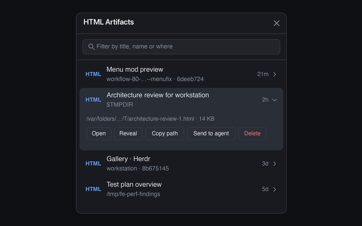

# HTML Artifacts

A side-panel list of the HTML reports agents write: the active project's Claude Code scratchpads, the top level of `$TMPDIR`, and `/tmp`, in one newest-first list for the last seven days, with Open, Reveal, Copy path, Send to agent and Delete on each row. It is a mod of its own, named `html-artifacts`; do not call it `artifacts`, because Herdr ships a built-in mod with that name and syncing would overwrite it.

## What you see

- The `toggle` role is a right-aligned 34×30px, 6px-radius button in a `theme().chrome` tab-bar strip with a 16px document glyph, `theme().selected` while its panel is open and `theme().hover` on hover. Its tooltip is "HTML Artifacts".
- The panel is a full-size `theme().background` card with 10px corners and a 1px `theme().border`. The 42px header reads **HTML Artifacts** and has Close. Type follows `settings().ui_font_size` (default 13px): title 14px, body 13.5px, secondary 12.5px, labels 12px.
- Below it, a filter box ("Filter by title, name or where"), then one list with no tabs.
- Rows are at least 48px high: an `HTML` (accent) tag, the report's `<title>` as its name (the file name when it has none), the place it came from (second line), and its age (`now`, `5m`, `3h`, `2d`). While the first scan runs there are four fading placeholder bars; a failed scan shows its error (over the rows, when some places did list); an empty list or filter says so.
- Clicking a row expands it on a `theme().raised` body with the full path, the size and the actions **Open**, **Reveal**, **Copy path**, **Send to agent** and **Delete** (red). A 34px footer shows a short notice for a few seconds after an action.
- One dialog: a 460×230 delete confirmation.

## How it behaves

- Only `.html` and `.htm` files modified in the last seven days are listed, in one list, newest first (equal times by name), at most 200. Markdown is never listed. The filter needs every word to appear in the title, the file name or where it came from, in any case.
- **Scratchpads** are `/private/tmp/claude-<uid>/<project>/<session>/scratchpad/` (Claude Code's per-session folder). Claude names `<project>` after the project's absolute path with every `/` and `.` written as `-` (`/Users/a/.herdr/x` becomes `-Users-a--herdr-x`). A project belongs to the active space when the focused terminal's folder (it wins over the space's folder, as in Skills) or the space's folder is that project, is inside it, or contains it (the folder's name followed by `-`, so `/x/app` also matches `/x/app-two`: a known fuzziness); when the project is an ancestor deeper than the home folder; or when it is a Herdr worktree of the same repo (`~/.herdr/worktrees/<repo>/…`, where `<repo>` is the worktree's repo folder, or the folder's own name for a main checkout). Files at the scratchpad's top level and one folder below are listed (the file name is the path inside the scratchpad). The place reads `<project folder> · <first 8 characters of the session id>`.
- **$TMPDIR** lists only the files directly in `$TMPDIR` (it holds tens of thousands of entries, so it is never walked or globbed: `find -maxdepth 1 -mtime -7`). They have no project, so all are listed; the place reads `$TMPDIR`. Matt Pocock's architecture review, for one, writes `$TMPDIR/architecture-review-<timestamp>.html` titled "Architecture review for <repo>".
- **/tmp** lists `/private/tmp` (else `/tmp`) down to two levels, without `claude-<uid>` (the scratchpads are listed on their own). The place is the folder, e.g. `/tmp/fe-perf-findings`. A file listed twice (`$TMPDIR` can be `/tmp`, which is `/private/tmp`) shows once.
- **Cloned sources and test output are skipped.** An HTML file in a subfolder of a scratchpad or of `/tmp` is not listed when that subfolder, or a folder between it and the source's top, is a checkout or build or test output, which is when either:
  - the folder directly holds a `.git`, a `package.json` or a `node_modules` (the scans print an `M <path>` line for each of these found one folder below the top), or
  - its name matches `NOISE_DIR` (case-insensitively) in `model.js`: `report_<digits>` (GdUnit4's `report_1`; `report_final` is kept); `test` followed by `report`, `reports`, `result`, `results` or `output`, with a dash, an underscore, a space or nothing between (`test-report`, `test_results`, `test output`, `testreport`); `playwright`, `allure`, `lcov` or `junit`, alone or followed by an optional dash, underscore or space and `report(s)` or `result(s)` (`playwright-report`, `junit-results`); `coverage`, `htmlcov`, `build`, `dist`, `target`, `node_modules`; or any name starting with `.`.

  HTML directly at the top of a source (a scratchpad, `$TMPDIR`, `/tmp`) is never skipped. Ordinary folder names such as `security-report`, `reports` or `architecture` are listed. The rule is `skipReport` and `NOISE_DIR` in `model.js`, tested without Herdr.
- A report's `<title>` is read (`head -c 8192`) for the 60 newest rows and remembered per machine, path, time and size, so a file is read again only when it changes.
- All sources are scanned together on the space's machine (`exec` with `on`) when the panel is shown, when the space or folder changes while it is shown, after a delete, and every 20 seconds while the panel is shown; a hidden panel never scans (showing it again does). A request that arrives during a scan (a delete, say) is remembered and runs when that scan ends. No folder is watched. A source that fails does not hide the others.
- **Open** opens the file with macOS `open` (the default browser). **Reveal** runs `open -R`. **Copy path** puts the path on the clipboard (`pbcopy`). **Send to agent** copies the path, focuses the focused (or last focused) agent and pastes it without pressing Enter, so the person reads it and sends; it refuses when no agent is live or the agent is blocked on a question. **Delete** asks first, then runs `rm` on that single file; it does not use the Trash. Open and Reveal need the space to be on this computer; for a space on another machine the panel says so, and Reveal is hidden.

## Built from

- Install the mod code and assets from `mods/html-artifacts/`. This recipe and `preview.png` sit in that folder; an installing agent leaves both out of `~/.config/herdr-app`. `mod.json` is `{ "place": "none", "title": "html-artifacts", "focusable": true }`; no key bindings ship.
- The default role is `panel`; `toggle` is the tab-bar button; its one dialog role is `delete`, opened as a `html-artifacts` overlay by the panel. The host layout needs column `panel` and stack `panel-body`, with this panel as child `html-artifacts` and the toggle in the tab row (Tony: block `html-artifacts-toggle`, 42px). The toggle calls `layout.select` and `layout.show`, or `layout.hide` when already shown.
- `main.js` draws the toggle, panel and dialogs and runs the actions. `model.js` has no Herdr import: the scan scripts, parsing, project matching, sorting, filtering, ages and HTML titles; `model.test.js` runs under plain `node --test mods/html-artifacts`.
- Herdr APIs: `exec`, `run` (`layout.select|show|hide`, `agent.focus`, `terminal.paste`), `spaces`, `agents`, `focused`, `layout`, `theme`, `settings`, `props`, `shared`/`setShared`, `openOverlay`/`closeOverlay` and timers.
- Shared state: every key starts with `html-artifacts.`: `html-artifacts.refresh.v1` (a delete dialog bumps it so the panel rescans).
- Programs run: `sh`, `find`, `stat`, `ls`, `printf`, `head`, `id`, `open`, `pbcopy` and `rm` (single file). Reads: file names and times under the places above, and the first lines of HTML reports. No network.
- Art is `icons/html-artifacts.svg`, `alert`, `check`, `chevron-down`, `chevron-right`, `close`, `copy`, `folder`, `open`, `search`, `send` and `trash`, 24×24 viewBox, tinted with theme colors, referenced as `mods/html-artifacts/icons/<name>.svg`.

## Watch out

- Do not name this mod or its layout child `artifacts`: Herdr ships a built-in mod by that name. Do not rename the folder to plain `artifacts` either: a folder of that name would overwrite Herdr's built-in mod.
- `$TMPDIR` is huge. Keep it at `-maxdepth 1` and never glob it in a shell; the same goes for scratchpad trees, which hold cloned source repositories.
- The scan reads `-mtime -7` in whole days; a file touched seven days ago can drop out an hour early.
- Project matching is by name: a project folder whose name only starts like the active one (`/x/app` and `/x/app-two`) matches too, and a main checkout's scratchpads only appear when its folder is the focused or the space's folder.
- Delete removes the file for good, and Send to agent only pastes; it never presses Enter.
- The machine's `stat` must be GNU (`-c`, tried first) or BSD (`-f`); Open and Reveal run on this computer only.

## Done when

- `herdr-app check mods/html-artifacts` and `node --test mods/html-artifacts` pass, as do `node tests/mod-isolation.test.js` and `sh tests/entries.test.sh`.
- In Tony, the toggle shows and hides the panel on the **HTML Artifacts** card, and the one list shows the real HTML reports of the active project's scratchpads, `$TMPDIR` and `/tmp`, newest first, with their titles and no Markdown, cloned repositories or test output.
- Open opens an HTML report in the browser; Reveal, Copy path and Send to agent work as described (Send refuses a blocked agent); Delete confirms and removes exactly one file and the list updates.
