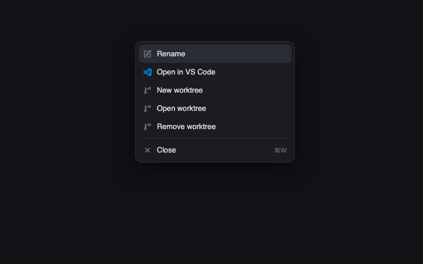

# Menu

Herdr's right-click and `+` context menu, cloned from the shipped `menu` mod with one addition: an **Open in VS Code** item on space menus. Because the folder is named `menu`, it replaces the built-in popup that [`tabs-icons`](../tabs-icons/RECIPE.md) and Herdr's own sidebars open.

## What you see

- A popup list with 5px padding on a `theme().popover` background, 12.8px text, and 31px rows. Each row has 8px horizontal padding, 7px corner radius and a 9px gap: a 14px icon, the label, and on the right an 11px `theme().dim` key hint when a global key is bound to the command.
- Icons are 14px, tinted `theme().muted`, from the `workspace-chrome` icon set (`x`, `square-pen`, `plus`, `git-branch`, `terminal`, `settings`, `panel-right`, `square`). The VS Code row uses this folder's `vscode.svg` in `#007acc`.
- The highlighted row (starts on the first) has `theme().selected` background; hovering a row uses `theme().hover`. A 1px `theme().border` line separates a **Close** row from what precedes it, **Keybinds** from the rows above it, and the theme block from the rows above it.
- What the popup lists depends on `props().tab`:
  - `pane`: **Split right**, **Split down**, **Zoom** (only for a pane in a tab; a terminal in a layout block or window has no pane to split); **Send right-clicks to pane** or **Use Herdr right-click menu** (toggles the terminal's `herdr.right-click` label); **Send back to &lt;parent&gt;** for a kept sub-agent; **Close pane**.
  - `tab`: **Rename**, **New tab**, **Close**.
  - `space`: **Rename**; **Open in VS Code** (this computer's spaces only); **New worktree** and **Open worktree** when the space's folder is in a git repository; **Remove worktree** when that folder is a linked worktree; **Close**.
  - anything else (`global`): **New space**, **Keybinds**, and **Theme:** graphite, ink, moss, atom one dark.

## How it behaves

- ↑/↓ move the highlight and wrap; Enter runs the row; Esc closes. Clicking a row runs it. The popup grabs keyboard focus when it opens.
- Choosing a row first closes the popup, then acts. Ordinary rows call `run(command, args)` with the app command named in the table above: `pane.split`, `pane.zoom`, `pane.close`, `terminal.right_click`, `terminal.park`, `tab.rename`, `tab.new`, `tab.close`, `space.rename`, `space.new`, `space.close`, `app.help`, `app.theme`.
- **Open in VS Code** runs `open -a "Visual Studio Code" <folder>` on macOS and `code <folder>` elsewhere. The folder is the space's first terminal's live working directory, else the folder the space was created in. It is hidden for remote spaces.
- **New / Open / Remove worktree** open Herdr's shipped `worktree` mod as a dialog with props `{ space, action: "new" | "open" | "remove" }` (440×260, or 560×480 for Open). The dialog makes and removes the checkouts; this mod only opens it.
- For a space menu, the mod runs `git rev-parse --show-toplevel` and `--git-common-dir` in the space's folder (on its machine) to decide between no worktree items, New/Open, and New/Open/Remove. Until that check returns, no worktree item shows.
- The key hint comes from `keys()`: the first `global` binding whose action is the command, or `<command>:<first arg value>` (for example `pane.split:right`).

## Built from

- This recipe and `preview.png` sit inside `mods/menu/` beside the mod. An installing agent copies `main.js`, `mod.json` and `vscode.svg` but leaves `RECIPE.md` and `preview.png` out of `~/.config/herdr-app`.
- `mods/menu/mod.json`: `{ "place": "none" }`. It is only ever opened as an overlay (`openOverlay({ mod: "menu", kind: "popup", width, props })`) by `tabs-icons` (and by whatever else in Herdr opens the shipped `menu`); it never has a layout block.
- `mods/menu/main.js`: a `View` subclass using `gpui-kit` `div`/`svg`, `gpui-base` `v_flex`/`h_flex`, and from `herdr`: `run`, `props`, `closeOverlay`, `openOverlay`, `theme`, `keys`, `terminals`, `spaces`, `panes`, `exec`, `window`. Menu items are `[label, command, args]` triples built by `items(props, git)`; the special commands `vscode` and `worktree` are handled in `choose()`.
- `mods/menu/vscode.svg`: the 24×24 VS Code mark, `currentColor` fill.
- It reads the `workspace-chrome` icons by path (`mods/workspace-chrome/<name>.svg`), so Herdr's shipped `workspace-chrome` mod must be present.

## Watch out

- The `worktree` dialog is a shipped Herdr mod, not part of this folder. Herdr has no app command that opens it with props, so `openOverlay({ mod: "worktree" })` is the only route; `tests/mod-isolation.test.js` lists `worktree` beside `menu`, `new-menu` and the other built-ins for that reason. Without Herdr's `worktree` mod the three worktree rows do nothing.
- This clone does not track upstream changes to the shipped `menu`; its copy of the item lists must be updated by hand.
- Open in VS Code on macOS needs the app installed (`open -a "Visual Studio Code"`); elsewhere it needs `code` on the PATH. Failures are silent.
- Rows are looked up by index in `items()` on every render, so the list must not change between render and Enter; the only async part is the git check, which re-renders.

## Done when

- `herdr-app check mods/menu` passes.
- Right-clicking a tab shows Rename / New tab / Close; right-clicking a pane shows the pane list; right-clicking a space in a git repository adds New worktree and Open worktree (and Remove worktree only inside a linked worktree), and a space in a plain folder shows neither.
- **Open in VS Code** appears for local spaces only, shows the blue VS Code icon, and opens the space's current folder in VS Code.
- ↑/↓/Enter/Esc work, clicking runs and closes, and key hints appear for commands with a global binding.
