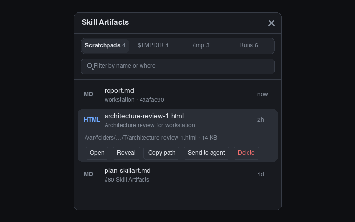

# Skill Artifacts

A side-panel list of the HTML and Markdown reports agents write: the active project's Claude Code scratchpads, the top level of `$TMPDIR`, `/tmp`, and the project's Herdr workflow runs. Newest first, last seven days, with Open, Reveal, Copy path, Send to agent and Delete on each row. It is a mod of its own, named `skill-artifacts`; do not call it `artifacts`, because Herdr ships a built-in mod with that name and syncing would overwrite it.

## What you see

- The `toggle` role is a right-aligned 34×30px, 6px-radius button in a `theme().chrome` tab-bar strip with a 16px document glyph, `theme().selected` while its panel is open and `theme().hover` on hover. Its tooltip is "Skill Artifacts".
- The panel is a full-size `theme().background` card with 10px corners and a 1px `theme().border`. The 42px header reads **Skill Artifacts** and has Close. Type follows `settings().ui_font_size` (default 13px): title 14px, body 13.5px, secondary 12.5px, labels 12px.
- Below it, a segmented control with four tabs and their counts, **Scratchpads**, **$TMPDIR**, **/tmp** and **Runs**, then a filter box ("Filter by name or where").
- Rows are at least 48px high: an `HTML` (accent) or `MD` (muted) tag, the file name, an optional second line (an HTML report's `<title>`), the place it came from, and its age (`now`, `5m`, `3h`, `2d`). While the first scan runs there are four fading placeholder bars; a failed scan shows its error; an empty tab or filter says so.
- Clicking a row expands it on a `theme().raised` body with the full path, the size and the actions **Open**, **Reveal**, **Copy path**, **Send to agent** and **Delete** (red). A 34px footer shows a short notice for a few seconds after an action.
- Dialogs: a 760×620 Markdown reader with **Open externally** and **Close**, and a 460×230 delete confirmation.

## How it behaves

- Only `.html`, `.htm` and `.md` files modified in the last seven days are listed, newest first (equal times by name), at most 200 per tab. The filter needs every word to appear in the file name or where it came from, in any case.
- **Scratchpads** are `/private/tmp/claude-<uid>/<project>/<session>/scratchpad/` (Claude Code's per-session folder). Claude names `<project>` after the project's absolute path with every `/` and `.` written as `-` (`/Users/a/.herdr/x` becomes `-Users-a--herdr-x`). A project belongs to the active space when the focused terminal's folder (it wins over the space's folder, as in Skills) or the space's folder is that project, is inside it, or contains it (the folder's name followed by `-`, so `/x/app` also matches `/x/app-two`: a known fuzziness); when the project is an ancestor deeper than the home folder; or when it is a Herdr worktree of the same repo (`~/.herdr/worktrees/<repo>/…`, where `<repo>` is the worktree's repo folder, or the folder's own name for a main checkout). Files at the scratchpad's top level and one folder below are listed (the row's name is the path inside the scratchpad); `node_modules` and `.git` are skipped. The row says `<project folder> · <first 8 characters of the session id>`.
- **$TMPDIR** lists only the files directly in `$TMPDIR` (it holds tens of thousands of entries, so it is never walked or globbed: `find -maxdepth 1 -mtime -7`). They have no project, so all are listed, and an HTML file shows its `<title>` as the second line (for example Matt Pocock's architecture review writes `$TMPDIR/architecture-review-<timestamp>.html` titled "Architecture review for <repo>"). HTML titles are read (`head -c 8192`) for the 30 newest HTML rows of a tab, and remembered per machine, path, time and size, so a file is read again only when it changes.
- **/tmp** lists `/private/tmp` (else `/tmp`) down to two levels, without `claude-<uid>` (the scratchpads have their own tab) or `node_modules` and `.git`. The row's place is the folder, e.g. `/tmp/fe-perf-findings`.
- **Runs** lists the `*.md` files directly in `~/.herdr/workflow-runs/<run>/` for runs that belong to the project. A run records its project in its `pane.json` (`folder`, the run's worktree, and `repoRoot`, the main checkout). A run belongs when the focused or space folder is the run's worktree or inside it, is inside its repo, or is another Herdr worktree of the same repo. The briefs Herdr writes for its agents (`worker.md`, `orchestrator.md`, `reviewer.md`, `investigator.md`, `brief-common.md`) are not listed. The row's place is the run's title.
- All four tabs are scanned together on the space's machine (`exec` with `on`) when the panel is shown, when the space or folder changes while it is shown, after a delete, and every 20 seconds while the panel is shown; a hidden panel never scans (showing it again does). A request that arrives during a scan (a delete, say) is remembered and runs when that scan ends. No folder is watched. The selected tab is remembered in `skill-artifacts.tab.v1`.
- **Open** opens an HTML or HTM file with macOS `open` (the default browser). A Markdown file is read (up to 1 MiB) and shown as selectable Markdown in the reader dialog, which can also **Open externally**. **Reveal** runs `open -R`. **Copy path** puts the path on the clipboard (`pbcopy`). **Send to agent** copies the path, focuses the focused (or last focused) agent and pastes it without pressing Enter, so the person reads it and sends; it refuses when no agent is live or the agent is blocked on a question. **Delete** asks first, then runs `rm` on that single file; it does not use the Trash. Open (HTML) and Reveal need the space to be on this computer; for a space on another machine the panel says so, and Reveal is hidden.

## Built from

- Install the mod code and assets from `mods/skill-artifacts/`. This recipe and `preview.png` sit in that folder; an installing agent leaves both out of `~/.config/herdr-app`. `mod.json` is `{ "place": "none", "title": "skill-artifacts", "focusable": true }`; no key bindings ship.
- The default role is `panel`; `toggle` is the tab-bar button; dialog roles are `reader` and `delete`, opened as `skill-artifacts` overlays by the panel. The host layout needs column `panel` and stack `panel-body`, with this panel as child `skill-artifacts` and the toggle in the tab row (Tony: block `skill-artifacts-toggle`, 42px). The toggle calls `layout.select` and `layout.show`, or `layout.hide` when already shown.
- `main.js` draws the toggle, panel and dialogs and runs the actions. `model.js` has no Herdr import: the scan scripts, parsing, project matching, sorting, filtering, ages and HTML titles; `model.test.js` runs under plain `node --test mods/skill-artifacts`.
- Herdr APIs: `exec`, `readTextFile`, `run` (`layout.select|show|hide`, `agent.focus`, `terminal.paste`), `spaces`, `agents`, `focused`, `layout`, `theme`, `settings`, `props`, `shared`/`setShared`, `openOverlay`/`closeOverlay` and timers.
- Shared state: every key starts with `skill-artifacts.`: `skill-artifacts.tab.v1` (the selected tab) and `skill-artifacts.refresh.v1` (a delete dialog bumps it so the panel rescans).
- Programs run: `sh`, `find`, `stat`, `ls`, `tr`, `id`, `open`, `pbcopy` and `rm` (single file). Reads: file names and times under the places above, `pane.json` of each run, and the first lines of HTML reports. No network.
- Art is `icons/skill-artifacts.svg`, `alert`, `check`, `chevron-down`, `chevron-right`, `close`, `copy`, `folder`, `open`, `ring`, `search`, `send` and `trash`, 24×24 viewBox, tinted with theme colors, referenced as `mods/skill-artifacts/icons/<name>.svg`.

## Watch out

- Do not name this mod or its layout child `artifacts`: Herdr ships a built-in mod by that name.
- `$TMPDIR` is huge. Keep it at `-maxdepth 1` and never glob it in a shell; the same goes for scratchpad trees, which hold cloned source repositories.
- The scan reads `-mtime -7` in whole days; a file touched seven days ago can drop out an hour early.
- Project matching is by name: a project folder whose name only starts like the active one (`/x/app` and `/x/app-two`) matches too, and a main checkout's scratchpads only appear when its folder is the focused or the space's folder.
- Delete removes the file for good, and Send to agent only pastes; it never presses Enter.
- The machine's `stat` must be GNU (`-c`, tried first) or BSD (`-f`); Open and Reveal run on this computer only.

## Done when

- `herdr-app check mods/skill-artifacts` and `node --test mods/skill-artifacts` pass, as do `node tests/mod-isolation.test.js` and `sh tests/entries.test.sh`.
- In Tony, the toggle shows and hides the panel on the **Skill Artifacts** card, and the tabs list the real reports of the active project's scratchpads, `$TMPDIR`, `/tmp` and runs, newest first, with counts that match.
- Open opens an HTML report in the browser and a Markdown report in the reader; Reveal, Copy path and Send to agent work as described (Send refuses a blocked agent); Delete confirms and removes exactly one file and the list updates.
