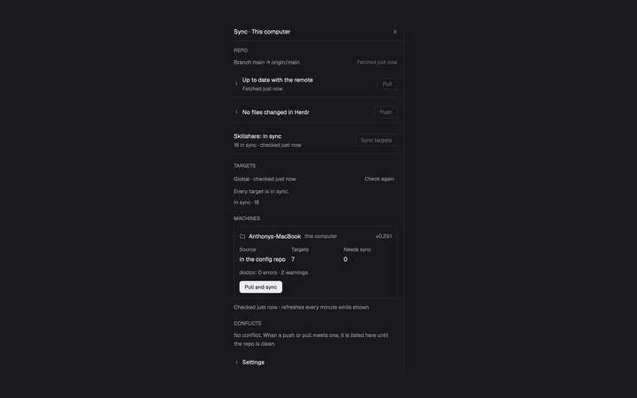

# Sync

A Herdr tab-bar button and side panel that keep a Git configuration repository and `~/.config/herdr-app` in step. **Sync** brings Herdr in line with the repository (one way) and checks the running Herdr loaded it; **Push** sends Herdr's changes to the repository (from `main` only). A picker chooses which worktree or branch is synced.

## What you see

- The default role is a right-aligned 34×30px button with 6px corners in a `theme().chrome` tab-bar strip. Its 16px circular-arrow icon is dimmed until a repository is configured, muted normally, foreground when its panel is selected, `theme().blocked` on an error, and spins once every 900ms while busy. A 9px yellow down arrow means the repository is behind its upstream; an up arrow counts changed files. Both sit at the button's top-right, with no numbers.
- Clicking the button opens **Sync · <machine>** in the host layout's shared side panel: a full-size `theme().background` card with 10px corners, a 1px `theme().border`, a 42px title bar with Close, and a scrolling body with 14px horizontal padding. Sections: **Repo**, then a collapsible **Settings** (the only section, forced open, until a repository is set).
- Repo shows, top to bottom: the branch and folder being synced (expands to the repo's worktrees and local branches; picking a worktree changes the folder, picking a branch runs `git switch` in it), a **Sync** row, and a **Push** row that expands to the changed files and an editable commit message. Disabled actions are dimmed and inert.

## How it behaves

- The button follows the active space's machine; repository path, sync script, picked worktree, state and locks are per machine. The button role owns all polling and work; the Details panel sends requests through persisted shared state.
- The local check runs every 20 seconds and `git fetch` every five minutes, plus on opening the panel or switching machine. It reads branch/upstream, up to 200 incoming and outgoing commits, uncommitted files, and a two-way sync-script dry run. Files the dry run would copy to the repository count as Herdr changes; files it would copy to Herdr are repository-newer and block Push. `.sync-backup/` is excluded.
- **Sync** is one way, repository to Herdr: fast-forward the repository to its upstream if behind (`--autostash`), run the sync script with `--push --prune` (files in a repo-owned mod folder that the repo lacks are moved to the backup folder), then `herdr-app check mods/<mod>` for each mod the repository owns and `herdr-app status` must show no errors. It never commits or pushes.
- **Push** runs only on `main` (checked in the UI and in the script). It refuses while repository-newer files exist, runs the script with `--pull`, restores and refuses if that would overwrite an uncommitted repository edit, commits everything except `.sync-backup`, fetches, rebases onto the upstream (aborting and pushing nothing if it does not apply cleanly), re-runs `--push` if commits came in, and pushes. There is no conflict resolution.
- The one setting is **Config repo** (empty by default; Browse is local-only). The script is always `./scripts/sync/sync.sh` in the repository. When it is missing and the repository has `scripts/sync/RECIPE.md`, **Generate sync.sh** opens an agent in a new tab to write it from that recipe.

### Sync script contract

The script is one quoted path, not a command line: absolute, `~/…`, or relative to the repository (`scripts/sync/sync.sh` and `./scripts/sync/sync.sh` are equivalent); spaces are allowed, arguments are not. It runs from the repository's top-level folder and must accept:

- `--push`: copy repository files to Herdr, with the repository winning.
- `--pull`: copy Herdr files to the repository, with Herdr winning.
- `--dry-run`: write nothing. With no direction flag, perform a two-way comparison and print one line per pending copy: `to repo: <path>` or `to repo (new): <path>` for Herdr-to-repository copies, and `to Herdr: <path>` or `to Herdr (new): <path>` for repository-to-Herdr copies. The mod parses those exact prefixes.

## Sync script

`mods/sync/sync.sh` is the script this mod runs. It is POSIX `sh` (`#!/bin/sh`, `set -eu`, executable), lives inside the mod, and is copied to Herdr with the rest of the mod, so `mods/sync/sync.sh` in a clone is also the one setup command. Its test is `mods/sync/sync.test.sh` (`sh mods/sync/sync.test.sh`); both are copied to Herdr like any other file in the mod folder.

### Purpose

Copy the repo's Herdr setup (mods, the Tony layout, themes, workflows) into the Herdr config folder, link Skillshare to the repo, and record which clone did it. The Herdr config folder is `${HERDR_APP_HOME:-$HOME/.config/herdr-app}` and must exist (Herdr must have been started once); the Skillshare folder is `${SKILLSHARE_HOME:-$HOME/.config/skillshare}`. The clone is `git rev-parse --show-toplevel` of the script's folder (two folders above the script when git is not available). Exit 1 if there is no `mods/` or `layouts/` folder there, if the Herdr config folder is missing, or if it lies inside the clone.

### Flags

| Flags | Meaning |
| --- | --- |
| none | Repo to Herdr, with prune; writes `sync.json`. |
| `--dry-run` | Write nothing (not `sync.json`, not links, not reinstalls); print what a real run would do. |
| `--check` | Stands alone; write nothing; exit 1 and name each line when `skillshare/config.yaml` holds an absolute home path. |
| `-h`, `--help` | Print usage, exit 0. Any other argument, or `--check` with `--dry-run`: usage to stderr, exit 2. |

There is no `--push`, `--pull` or `--prune`, and no two-way mode: Herdr-side edits are overwritten and never copied back.

### Output

One line per change, `<what>: <path>` with `<path>` relative to the Herdr config folder:

- `to Herdr (new): <path>` and `to Herdr: <path>`: a file copied (or, with `--dry-run`, that would be copied) to Herdr.
- `removed from Herdr: <path>`: a file deleted by the prune.

Then summary lines: `copied: <n> to Herdr, <m> removed from Herdr; <k> already the same` (`would copy` with `--dry-run`), `linked: <config>/sync.json` (`would link` with `--dry-run`), `skillshare: linked <n>, <m> already linked` (`would link` with `--dry-run`), and, for recorded skills, `reinstalled: <name>`, `would reinstall: <name>` and `skillshare: could not reinstall <name>: <reason>`. A caller that only needs the result reads the exit code and the `copied:` summary.

### What goes where (repo to the Herdr config folder)

- `mods/<mod>/` to `mods/<mod>/` for every mod, including `mods/sync/sync.sh` and `mods/sync/sync.test.sh`. Herdr does not load a mod's assets through a symlink, so Herdr holds real copies (a symlink left by an older version is replaced with a copy first).
- `layouts/Tony.json` to `layouts/Tony.json`.
- The root `preview.png` to `layouts/Tony.png`: Tony's preview, which Herdr's layout picker shows.
- `personal/herdr-app/themes/<file>` to `themes/<file>`, and `personal/herdr-app/workflows/<file>` to `workflows/<file>`: only files the repo has.
- Never copied: each mod's `RECIPE.md` and `preview.png`, `keys.json` and `settings.json` (Herdr writes them), `.DS_Store`, `gpui-kit.d.ts`, `jsconfig.json`, `layouts/.state/*`.
- The repo always wins: a differing file in Herdr is overwritten, whichever is newer. Nothing is ever written to the repo, and nothing is backed up (no `.workstation-backup/`, no `.sync-backup/`).
- Prune: a file inside a repo-owned mod folder in Herdr (`mods/<mod>/` for a mod the repo has) that the repo does not have is deleted, and a folder that leaves empty goes with it. Other Herdr files, themes, workflows and mods the repo does not own are never removed.

### sync.json

Every real run writes `<config>/sync.json` last-run-wins, as one JSON line (written to a temporary file and moved into place): `{"repo": "<git rev-parse --show-toplevel>", "remote": "<git remote get-url origin>"}`. `remote` is an empty string when there is no `origin` (or no git). Both values are JSON-escaped. This is how the Sync mod, on any machine, finds the clone to watch.

### Skillshare

`~/.config/skillshare/{config.yaml,agents,skills}` become symlinks to `skillshare/<name>` in the clone. A real file or folder in the way is moved to `<name>.backup-<timestamp>` first (the one backup that stays); a link that is already right is left alone (`link ok: <path>`); a link elsewhere is repointed. A name the repo does not have is skipped. `skillshare/config.yaml` sets `preserve_tilde_on_save: true`, and each real run rewrites `$HOME/` to `~/` there so the username never reaches a commit (`--check` fails if an absolute home path remains).

Only `skillshare/skills/mine/` and `skillshare/skills/.metadata.json` are committed; every other top-level folder under `skillshare/skills/` is ignored by git, and installed skills are recorded in `.metadata.json` (`repo_url`, `subdir`, `commit` per entry).

### Reinstall recorded skills

After linking, every real run reinstalls each recorded skill whose folder is missing under `${SKILLSHARE_HOME:-$HOME/.config/skillshare}/skills`, so a fresh clone gets them back at the recorded commit:

- Per entry, parse `.metadata.json` with `awk` (no `jq` or `node`): entries are indented 4 spaces and their fields 6. Run `skillshare install <source> --name <entry> --branch <commit> -y -g`, where `<source>` is `repo_url` without `https://` and `.git`, plus `/<subdir>` (for an `ssh` `git@` URL, `//<subdir>`). `--branch` pins the recorded commit (a full SHA); a plain `skillshare install -g` would install an entry without a recorded branch from its latest commit.
- Skillshare ignores `SKILLSHARE_HOME`: it installs where the config's `sources.skills` says, and the repo's config says `~/.config/skillshare/skills`, which expands from `HOME`. So when `SKILLSHARE_HOME` is set, run Skillshare with `SKILLSHARE_CONFIG` pointing at a temporary copy of `$SKILLSHARE_HOME/config.yaml` whose `sources:` section is replaced by `skills: $SKILLSHARE_HOME/skills` and `agents: $SKILLSHARE_HOME/agents`.
- Reinstalling rewrites the entry's `source`, `branch` and `installed_at` in `.metadata.json`. Copy the file first and put it back afterwards, also from the exit trap (the script traps `INT`, `TERM` and `HUP`), so an interrupted install leaves the committed record untouched.
- Print `reinstalled: <name>` after a successful install (the folder must exist afterwards). `--dry-run` prints `would reinstall: <name>` instead and does not need the CLI; when the skills link would still be created, it looks in `skillshare/skills` in the clone. `--check` never reinstalls. The script does not run `skillshare sync`; run it afterwards to link the skills into your tools.
- Never fatal. An entry without `repo_url`, a missing `skillshare` CLI, or a failed install (offline) prints `skillshare: could not reinstall <name>: <reason>` (the last non-empty line `skillshare` printed with `\r` and ANSI colour codes removed, or `no repo_url is recorded for it`, or `the skillshare CLI was not found`); the rest of the run finishes and the exit status stays 0. Skipped when `.metadata.json` does not exist.

To reinstall one entry by hand: `skillshare install <repo_url-without-https-and-.git>/<subdir> --name <name> --branch <commit> -y -g`, then `git checkout skillshare/skills/.metadata.json`. To try an install without touching the real Skillshare folder, point Skillshare at a scratch one (it reads `XDG_CONFIG_HOME`, or `SKILLSHARE_CONFIG` with absolute scratch `sources`; it does not read `SKILLSHARE_HOME`).

## Built from

- Install `mods/sync/`. `RECIPE.md` and `preview.png` sit inside `mods/sync/`, and an installing agent leaves them out. Its `mod.json` is `{ "place": "none", "title": "sync" }`; there are no key bindings. The host layout must mount the always-present default/`button` role and should place a `details` role as child `sync` in stack `panel-body` inside column `panel`. The button calls `layout.select`, `layout.show` and `layout.hide` on those ids. Other props roles are `text`, `upgrade` and `srcboth` dialogs, opened by the mod itself.
- `main.js` owns roles, machine context, polling, shared state, locks and operations. `model.js` contains settings, output parsers, badge/count logic and the main-only rule. `ops.js` contains the check, sync, push, list and switch shell scripts. `jobs.js` runs slow work as detached, polled jobs; `channel.js` serializes work per machine.
- `details.js` composes `repo-ui.js` and `settings-ui.js`. `ui.js` supplies the themed controls.
- Herdr APIs include `exec`, `run`, `spaces`, `machines`, `focused`, `layout`, `theme`, `shared`/`setShared`, `knownAgents`, `pickFolder`, `openOverlay`/`closeOverlay`, `notify`, `readTextFile`, timers and `props`. App actions include `layout.select`, `layout.show`, `layout.hide` and `tab.new`.
- Programs and shell utilities include `sh`, `git`, `herdr-app`, `hostname`, `mktemp`, `rm`, `cp`, `mkdir`, `find`, `cat`, `grep`, `sed`, `awk`, `cut`, `paste`, `head`, `tail`, `tr`, `cmp`, `ps`, `kill`, `sleep` and `date`. Long jobs detach with `setsid` where available or shell job control otherwise, clear `HC_SCOPE`, poll files in a temporary directory, and time out after 15 minutes.
- Network access is through `git fetch`, `git pull` and `git push`. It reads and writes the chosen config repository and causes `scripts/sync/sync.sh` to read/write `~/.config/herdr-app`; it also writes temporary job files.
- Art is `icons/sync.svg`, `arrow-up.svg`, `arrow-down.svg`, `ring.svg`, `alert.svg`, `check.svg`, `chevron-down.svg`, `chevron-right.svg`, `close.svg`, `folder.svg` and `settings.svg`, referenced as `mods/sync/icons/<name>.svg` and tinted with theme colors.

## Watch out

- **Real side effects:** Sync and Push run the configured script and perform Git commits, rebases, network fetches and pushes. None of these is a simulated gallery preview.
- The button role must remain mounted even while the panel is closed; it owns the locks, timers and background work. A Details panel by itself is not enough. The `panel`/`panel-body`/`sync` ids must match the host layout or the toggle must be adapted.
- The sync script's dry-run output is an interface, not incidental logging. Missing prefixes or a script that writes during `--dry-run` produce wrong badges or unsafe Push decisions. The repository branch needs an upstream for Push.
- Sync removes files only inside repo-owned mod folders (to the backup folder); other Herdr files, mods and layouts are never removed.
- The check reads at most 200 commits in each direction; expanded UI lists are capped at 50 pull entries and 100 push files. Source state retains at most 300 uncommitted files and displays 40. Renaming the mod requires updating all `mods/sync/` asset paths and its self-opened mod name.
- `git`, `sh` and the sync script are required; `herdr-app` is needed for the loaded-in-Herdr check (Sync still runs without it and says it did not check).

## Done when

- `herdr-app check mods/sync` passes. With no repository configured, only open Settings appears; saving a test repository path, script and agent enables the button and panel for that machine.
- A two-way `--dry-run` produces the exact four recognized line prefixes, and the down/up arrows track incoming commits and changed files without numbers. Opening the panel fetches; closing it stops the panel-only reads.
- In throwaway repositories, Sync makes Herdr match the repository, backing up replacements through the script. Push copies Herdr changes, commits, rebases and pushes; repository-newer files block it, and it is refused off `main`.
- A push that cannot rebase or would overwrite an uncommitted repository edit pushes nothing and says why. Picking a worktree or switching a branch changes which folder Sync, Push and the check use.
- `node --test mods/sync` passes after a rebuild.
