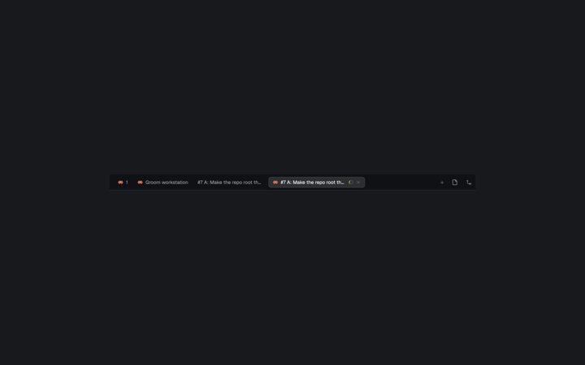

# Tabs Icons

Tabs Icons is a Herdr tab bar with program icons, agent status, draggable pills, per-space side-panel memory and platform window controls. It is derived from Herdr's built-in `tabs` mod and fits host layouts that expose the panel ids described below.



## What you see

- The tab row has a `theme().chrome` background, a bottom border and 10px horizontal padding. Tabs are nonstretching 29px-high pills with 10px horizontal padding, 7px internal gaps, 7px corners, 12.8px text and 3px between tabs. The active pill has a `theme().raised` fill, `theme().border` outline and foreground text; inactive pills use chrome fill, chrome outline and muted text. All gain `theme().hover` on hover.
- A tab can show its 14px program icon, a name truncated to 170px, and ` Z` when zoomed. Working agents add a 12px spinner; blocked and done agents add a 6px status dot. The active tab has a 12px close icon.
- A right-aligned **+**, optional Files and Changes buttons, and platform window controls follow the scrolling tab list. Files and Changes appear when listed in shared `workspace.panels` (default `[]`, so both are hidden).
- Where Herdr reports native window buttons, the row adds minimize, maximize/restore and close controls. Windows uses the included vector art; other platforms use text symbols and the built-in pane close asset. On macOS with the title bar hidden and not fullscreen, left padding grows to keep tabs clear of the configured traffic lights, including when the sidebar is hidden or narrow.

## How it behaves

- The mod chooses a tab's first agent program icon, falling back to its first pane's program. A generated name matching `tb<number>` displays that program's name (or `Terminal`); a manually assigned tab name stays unchanged.
- Working status spins once every 900ms using `theme().working`; blocked and done dots use their matching theme colors; idle and unreported statuses add no status marker.
- Click a tab to select it. Double-click its label to run `tab.rename`. Press one tab and release over another to move it to that position. Right-click opens the `menu` popup ([`mods/menu`](../menu/RECIPE.md), this repo's own copy) for that tab and space. Vertical wheel scrolling over the tab row runs `tab.prev` or `tab.next`. The active tab's close icon runs `tab.close` without also selecting the tab.
- **+** opens the built-in `new-menu` popup at 250×512. Each Files or Changes button selects its child in `panel-body` and shows `panel`, or hides the panel if already selected.
- The mod remembers the selected open side panel per space in its own `localStorage` under `panels`. Switching spaces restores that space's enabled panel, or closes it; a panel outside `workspace.panels` is not restored. A one-second pending window prevents the restore from being saved over before it lands.
- Mouse-down stops propagation on pills and controls so they do not start a window drag. The horizontal tab list uses `overflow_x_scrollbar`.

## Built from

- Install `main.js`, `mod.json` and the four window-control SVGs from `mods/tabs-icons/`. This recipe and `preview.png` sit inside that folder; an installing agent leaves both out of `~/.config/herdr-app`.
- `mod.json` is:

  ```json
  {
    "place": "none",
    "title": "Tabs",
    "cloned_from": { "name": "tabs", "version": "0.1.13" }
  }
  ```

- The mod is derived from Herdr's built-in **`tabs`** mod, licensed **Apache-2.0**. `main.js` is a `gpui-kit` `View` built with `div`, `h_flex`, `svg` and `image`. It uses Herdr's `spaces`, `panes`, `run`, `openOverlay`, `theme`, `window`, `shared`, `layout`, `settings` and per-copy `localStorage`.
- `spaces()` supplies the active space's `id` and `tabs`. Each tab uses `id`, `name`, `active`, `zoomed` and `status` (`working`, `blocked`, `done`, or another value for no marker). `panes()` supplies each pane's `tab` and optional `program`, whose `agent`, `name`, `icon` and `tint` fields select and render the program icon/name.
- `layout()` supplies the root `traffic_lights` and a recursive `id`/`children` tree. The mod finds `sidebar`, `panel` and `panel-body`, reading `sidebar.hidden`, `sidebar.size.px`, `panel.hidden` and `panel-body.active`. `window()` supplies `platform`, `titlebar`, `fullscreen`, `buttons` and `maximized`. `shared("workspace.panels")` is the array of enabled panel child ids. The `localStorage` value `panels` is an object keyed by space id, with a panel child id or `null` for each space.
- `tab.rename`, `tab.select` and `tab.close` receive `{ "id": "<tab-id>" }`. `tab.move` receives `{ "id": "<dragged-tab-id>", "index": <one-based-target-index> }`, where the target is the released-over tab's zero-based position plus one. `tab.prev` and `tab.next` receive no argument object.
- `layout.select` receives `{ "stack": "panel-body", "child": "<panel-child-id>" }`; `layout.show` and `layout.hide` receive `{ "id": "panel" }`. `window.minimize`, `window.maximize` and `window.close` receive no argument object.
- Right-click uses `openOverlay({ mod: "menu", kind: "popup", width: 200, props: { tab: "tab", target: { id: "<tab-id>", space: "<space-id>" } } })`. **+** uses `openOverlay({ mod: "new-menu", kind: "popup", width: 250, height: 512 })`.
- On macOS with `titlebar === "none"`, not fullscreen, and root traffic lights present, the tab row's left padding is exactly:

  ```js
  Math.max(10, (root.traffic_lights[0] + 64) / settings().zoom -
    (sidebar?.hidden ? 0 : sidebar?.size?.px ?? 0))
  ```

  Otherwise it is 10px. Thus the formula divides the traffic-light offset plus 64 by the zoom, subtracts the visible sidebar width (zero when hidden), and clamps the result to at least 10px.
- Its own art is `win-min.svg`, `win-max.svg`, `win-restore.svg` and `win-close.svg`. A truthy `program.tint` renders `program.icon` as a theme-muted, tinted `svg`; a falsy value renders it as a full-color `image`. The four window-control SVGs contain:

  `win-min.svg`:
  ```svg
  <svg xmlns="http://www.w3.org/2000/svg" width="16" height="16" viewBox="0 0 16 16" fill="none" stroke="currentColor" stroke-width="1"><path d="M3 8.5h10"/></svg>
  ```

  `win-max.svg`:
  ```svg
  <svg xmlns="http://www.w3.org/2000/svg" width="16" height="16" viewBox="0 0 16 16" fill="none" stroke="currentColor" stroke-width="1"><rect x="3.5" y="3.5" width="9" height="9"/></svg>
  ```

  `win-restore.svg`:
  ```svg
  <svg xmlns="http://www.w3.org/2000/svg" width="16" height="16" viewBox="0 0 16 16" fill="none" stroke="currentColor" stroke-width="1"><path d="M5.5 3.5h7v7"/><rect x="3.5" y="5.5" width="7" height="7"/></svg>
  ```

  `win-close.svg`:
  ```svg
  <svg xmlns="http://www.w3.org/2000/svg" width="16" height="16" viewBox="0 0 16 16" fill="none" stroke="currentColor" stroke-width="1"><path d="m3.5 3.5 9 9m0-9-9 9"/></svg>
  ```

- It also references shipped assets `mods/workspace-chrome/spinner.svg`, `mods/pane/close.svg`, `mods/files/file.svg` and `mods/changes/changes.svg`. No `keys.json` belongs to this mod: it supplies no mod-specific key bindings.

## Watch out

- The host layout must explicitly place the mod because `place` is `none`. It additionally needs the repo's own `menu` mod (`mods/menu`) and the built-in `new-menu`, `workspace-chrome`, `pane`, `files` and `changes` for the popups and shipped assets named above.
- The Files/Changes toggles and per-space memory depend on the exact ids `panel` and `panel-body`, and child ids `files` and `changes`. Changing them requires changing the mod too. Other custom toggles in Tony follow the same host-panel convention.
- The mod runs no external programs, reads no files outside Herdr's mod state and makes no network requests.
- Renaming `tabs-icons` requires changing the layout reference and its four `mods/tabs-icons/win-*.svg` paths.
- The preview is a cropped screenshot of the tab row, not an additional layout asset; it is not copied during installation.

## Done when

- `herdr-app check mods/tabs-icons` passes and the host layout shows the icon-rich tab row without errors.
- Tabs show the correct program/name and working, blocked, done and idle treatments; select, double-click rename, drag reorder, right-click menu, wheel navigation, close and + all work.
- Window controls and macOS traffic-light spacing remain usable at different sidebar widths and zoom levels.
- Files/Changes visibility follows `workspace.panels`; each button opens or hides its matching panel, and switching spaces restores only that space's remembered enabled panel.
- The installed mod folder contains code and art only, with no `RECIPE.md` or `preview.png` copied from the gallery entry.
