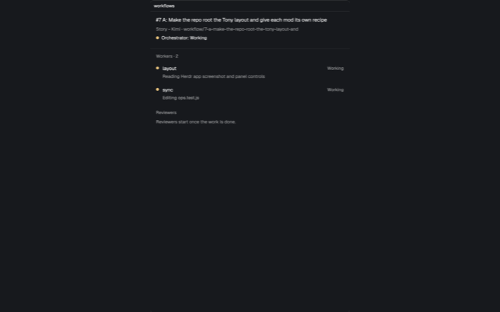

# Workflows

Workflows edits Herdr's YAML workflow definitions and shows each run's orchestrator, workers and reviewers, including finishing and pull-request controls. Its companion [GitHub Tasks mod](../github-tasks/RECIPE.md) supplies Project tickets, saved-label matching and workflow Start actions. Bug and Story starter YAML files are included.



## What you see

The Workflows panel role is a full-size card with 10px rounded corners, a 1px `theme().border`, `theme().background` fill and theme foreground text. The type scale starts at `settings().ui_font_size`, defaulting to 13px: titles are 1px larger, body text 0.5px larger, secondary text 0.5px smaller and labels 1px smaller. Icon buttons are 24×24px with 6px corners and a 14px muted glyph; 28px-high action buttons have 12px horizontal padding and 6px corners, either solid `theme().solid`/`solid_foreground` or a quiet border. Disabled actions are inert at 40% opacity.

- Its tab-bar toggle is a right-aligned 34×30px, 6px-radius Workflows icon button in an 8px-right-padded `theme().chrome` strip with a bottom border. The 42px panel header reads **Workflows**, with Settings and Close. Below it is a solid **New workflow** button.
- A header names the selected repository, or **Global** outside a local Git repository. In a repository, an All/Project/Global segmented control shows counts. Rows are sorted case-insensitively by name, show a Global or repository badge in the mixed view, and have a trash button. The first trash press shows `Delete?` for three seconds; the second deletes. Invalid files stay listed with their parse error.
- The editor's scrollable form contains Name, Trigger labels, Any/All matching when multiple labels exist, Branch/Worktree strategy, and Global/Repo storage. Three bordered role cards—Orchestrator, Worker and Reviewer—each contain Agent, Model, Effort (`low`, `medium`, `high`, `xhigh`, `max`) and Prompt. Orchestrator adds Planning and Retro prompts; Worker adds Testing rules. A custom agent reveals its Command field.
- Trigger labels appear as removable 26px pills with repository label colors, and completion offers up to six matching repository labels. Model completion offers up to eight matches: built-in Claude names, or models read from Codex/Kimi configuration. Agent selection is a searchable 320px-wide dialog. Save/Revert, unsaved state, conflict handling and `Cmd-S` parallel the GitHub Tasks ticket editor.
- Workflow Settings is a read-only scrolling page showing the complete built-in orchestrator, worker and reviewer instructions with sample placeholders substituted.
- A run page has the ticket title, workflow and branch in its header, plus the orchestrator's status dot and text. It lists **Workers** and **Reviewers**, live ones first and then in start order; ended agents seen during the page's lifetime remain as Finished. Rows show name, status and the agent's current report or terminal title. Blocked rows are selected-colored, and a banner says how many agents are waiting. Clicking a live row opens `terminal.peek`.
- Status text/colors are Working/`working`, Needs you/`blocked`, Done/`done`, Idle/`idle`, Error/`ansi1`, Finished/`dim`, and an unreported live agent is Running/`unknown`. The orchestrator's ended state explains that its agents ended and the branch remains.

## How it behaves

### Workflow files and editing

- Workflows live as `<id>.yaml` in the Herdr home's `workflows/` directory (global) or `<repo>/.herdr/workflows/` (project). Legacy `.json` files still load and become YAML on save; YAML wins when both exist. Project files appear only for a selected local repository. The visible panel rescans every five seconds and after changes.
- A definition has `version: 1`, id, name, `branch` or `worktree` strategy, trigger labels with `any`/`all` matching, and orchestrator/worker/reviewer role settings. Labels match case-insensitively. A workflow with no labels is a fallback used only when no labeled workflow matches. The companion GitHub Tasks mod uses the ticket's **saved** labels to choose a workflow and start it.
- New workflow ids are 60-character lowercase slugs of their names. Validation requires a useful unique name, valid strategy/match/efforts, and a command for each custom agent. Saving uses expected old text to detect concurrent changes; moving scope writes the destination before removing the source. Deletion is the two-press action above.
- GitHub Tasks resolves installed agents before changing the checkout and opens a local orchestrator plus a `workflows` run pane. Claude workers use `acceptEdits`, reviewers use `plan`, and the orchestrator keeps the user's permission mode. Each run writes its prompts and an executable `spawn` script under `~/.herdr/workflow-runs/<run-id>/`; that script—not unrestricted `hc run`—is the prescribed way to start workers/reviewers.
- Without GitHub Tasks, Workflows still lists, creates, edits, validates, moves and deletes global/project definitions and shows Workflow Settings. Ticket discovery, saved-label matching and starting new runs are unavailable. Existing run panes can still display agents and offer their saved Finish/Create PR controls when their props contain the required run context.

### Run status and finishing

- The run page reads terminal labels `herdr.workflow.run`, `herdr.role` and `herdr.workflow.name`. Once a worker has appeared it tries to move the ticket to the configured in-progress status (default In Progress); once a reviewer appears it tries the configured in-review status (default In Review). GitHub Tasks Start passes both names to the run pane as `props.statuses` (`{ inProgress, inReview }`, also saved in `pane.json`); runs without them use the defaults. Status names ignore punctuation/case, stages never go backward, and a missing option or failed mutation produces at most one warning for that stage.
- The built-in orchestrator keeps each reviewer available while fixes are checked. It ends a reviewer with `hc kill <name>` once that reviewer reported no findings needing fixes or confirmed its findings are addressed; it does not tell workers to end just to unblock Finish.
- A worktree run shows **Finish** only after a reviewer has appeared (the run's In Review stage), every reviewer has stopped and no worker is still working. Live idle or done workers do not block it. Finish requires clean worktree and main checkout, switches the repository to its default branch, merges with `git merge --no-edit`, removes the worktree, deletes the merged branch, kills/removes the other run terminals, and closes the orchestrator tab. A merge failure attempts `git merge --abort`.
- A branch run shows **Create PR**, which pushes the branch to origin and runs `gh pr create`, with `Closes #<ticket>` in the body when numbered. It polls `gh pr view` every 30 seconds until merged, turning the button into a PR link. Finish appears only after a reviewer has appeared, every reviewer has stopped, no worker is still working and the merged state is observed; live idle or done workers do not block it. It checks again, switches the clean main checkout to the default branch, deletes the local branch with `-D`, and closes the session.

## Built from

### Installation and host layout

- Install the mod code and icons from `mods/workflows/`. This recipe and `preview.png` sit inside that folder; an installing agent leaves them and `starters/` out of `~/.config/herdr-app/mods/workflows/`. Copy starters separately as described below. Install the companion `mods/github-tasks/` mod too for ticket-driven runs.
- `mod.json` uses `"place": "none"`, title `workflows`, and `"focusable": true`. There is no `keys.json`: no mod-specific bindings ship. The default panel role handles the optional mod command `focus` by focusing its handle.
- The default panel and `toggle` role expect layout nodes with ids `panel` and `panel-body`, where `panel-body` is a stack containing a `workflows` child. Toggle on runs `layout.select` and `layout.show`; toggle off runs `layout.hide`. A typical tab-bar block passes `{ "role": "toggle" }`.
- Other props roles are `editor` (`id`, `scope`, `where`, `repoRoot`), `settings` (no required props), and `run` (`id`, `orchestrator`, `title`, `workflow`, `branch`, `strategy`, `repoRoot`, `folder`, `ticket`, `projectId`, `statusField`, optional `statuses`). The mods open editor tabs and run panes themselves.

### Source organization and APIs

- `main.js`: panel/toggle roles and file list. `model.js`: workflow schema, validation, normalization and YAML serialization. `store.js`: conflict-aware storage independent of Herdr I/O. `env.js`: real file/git/GitHub adapters and model-file reads. `editor.js`: the complete workflow form. `labels.js`, `models.js` and `places.js`: completion and path logic. `run.js`: live run page and finishing actions. `runview.js`: terminal rows/status mapping. `finish.js`: status, PR, merge and cleanup command construction. `settings.js` and `prompts.js`: read-only built-in instructions. `ui.js`: shared controls. `yaml.js`: dependency-free YAML/JSON subset support.
- Herdr data/actions include `spaces`, `focused`, `layout`, `theme`, `settings`, `props`, `shared`/`setShared`, `nextCommand`, `knownAgents`, `terminals`, `panes`, `run`, `notify`, `home`, `appHome`, `readTextFile`, `writeTextFile`, `exec`, `hc`, timers, URL opening and clipboard writing. App commands include `layout.show`, `layout.hide`, `layout.select`, `tab.new`, `tab.rename`, `tab.select`, `tab.close`, `space.select`, `pane.split`, `pane.focus` and `terminal.peek`.
- Programs run locally or, for repository reads where supported, on the space's machine: `gh`, `git`, `sh`, `ls`, `rm`, `mkdir`, `chmod`, `herdr-app` and `hc`. GitHub network access is performed by `gh`; the mod source does not call `fetch` directly.
- SVG art lives under `icons/`: `workflows`, `settings`, `close`, `plus`, `folder`, `trash`, `alert`, `search`, `check`, `external` and `chevron-down`. They are 24×24-viewBox rounded-stroke `currentColor` glyphs, referenced as `mods/workflows/icons/<name>.svg`.
- Workflows and GitHub Tasks cannot import each other. Their duplicated YAML and prompt/status helpers must remain in step.

### Starter files

From the repository root, copy the examples into the global workflows directory without replacing existing files:

```sh
mkdir -p ~/.config/herdr-app/workflows
cp -n mods/workflows/starters/*.yaml ~/.config/herdr-app/workflows/
```

They are starter examples to edit in the Workflows panel, not separate mods; leaving them only in `starters/` does not make them global workflows.

- `starters/bug.yaml`: id/name Bug, worktree strategy, triggered by the `bug` label. Orchestrator uses Claude `opus` at high effort; planning requires reproduction and a failing test before an agreed fix. Worker uses `sonnet`/medium and reviewer `haiku`/low. The supplied worker and reviewer prompts intentionally tell those roles to report and stop without changing anything, because this starter keeps the fix gate with the user in the orchestrator session.
- `starters/story.yaml`: id/name Story, worktree strategy, no trigger labels so it is the fallback. Orchestrator uses Claude `opus`/high with repository exploration, grilling and plan acceptance; worker uses `sonnet`/high with TDD, repository conventions and ticket-referencing commits; reviewer uses `sonnet`/high for a read-only review against `origin/main` and the ticket brief. Its worker testing field requires the repository's tests and lint to pass.

## Watch out

- **Network, programs and files outside the mod:** Workflows uses `gh` for GitHub reads/writes and PR creation, Git operations including push/merge/cleanup when explicitly requested, and local agent programs through its companion. It reads/writes global and repository workflow files, reads `~/.codex/models_cache.json` and `~/.kimi-code/config.toml` for completion, and inspects/controls Herdr terminals with `hc`. GitHub Tasks writes run folders and creates/switches branches and worktrees when starting a run.
- `gh`, `git`, `sh`, `herdr-app`, `hc` and the selected agents must be installed for their respective functions. GitHub access needs the `project` scope for ticket-driven runs. Workflow file writes are local-only; repository discovery can run on a remote space.
- Installing the mod does not by itself add its blocks to a layout or copy starter YAMLs into the global workflows directory. Installing only Workflows leaves ticket matching and starting unavailable.
- Renaming either companion requires updating asset paths, layout mod names, role-based tab/pane creation, and the hard-coded `workflows` run-pane reference. Keep duplicated helper modules synchronized.
- Finish and Create PR perform real outward/destructive Git operations only after their explicit buttons; a failed multi-step finish can leave earlier steps completed. A worktree removed by Finish cannot be recovered as a worktree, though its merged commits remain.
- The small YAML implementation supports the workflow schema, comments, quoted strings, block scalars and simple lists; it is not a general YAML package. Lists of maps and inline maps other than `{}` are rejected.

## Done when

- `herdr-app check mods/workflows` passes. Its toggle selects/shows and hides the expected `panel`/`panel-body` block, and the panel command `focus` works.
- Workflows lists global and local-repository files, creates/edits/moves/deletes YAML with validation and conflict detection, reloads external changes, and completes trigger labels and models. Bug and Story appear after their YAML files are copied to `~/.config/herdr-app/workflows/`.
- Without GitHub Tasks, those list/edit/settings operations still work; ticket discovery, matching and new-run Start controls are not promised. An existing run pane with complete saved props still renders its agents and status.
- With GitHub Tasks installed, a test run opens an orchestrator plus run pane, spawns labeled workers/reviewers, displays every live/finished status, peeks at live agents, and advances the ticket through In Progress/In Review. A missing run pane can be restored from the ticket's View action.
- Worktree Finish is gated on In Review, stopped reviewers and no worker still working, then merges and cleans up only with clean checkouts; branch Create PR pushes and opens the expected PR, then Finish additionally remains unavailable until that PR is merged. Live idle or done workers do not block either Finish action.
- The existing `node --test` suite passes after a rebuild; the companion GitHub Tasks suite passes too when both are installed for integration.
